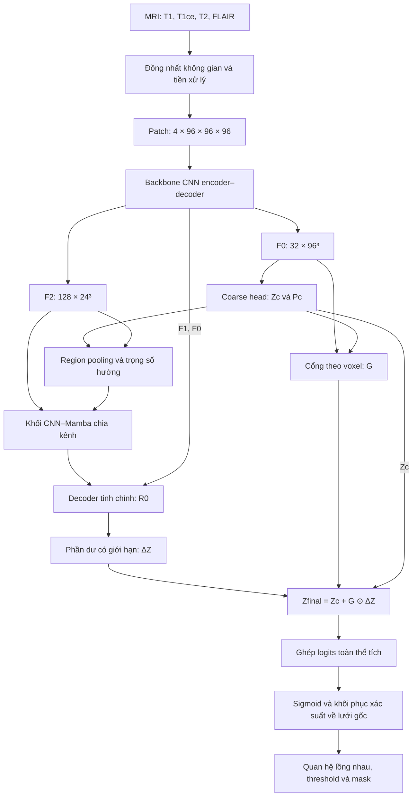

# CGR-Mamba — Coarse-Guided Residual Mamba Network

**Đặc tả kiến trúc phân đoạn u não 3D từ dữ liệu MRI đến đầu ra**  
**Phiên bản:** 1.0 · **Ngày:** 15/10/2026 · **Trạng thái:** Thiết kế đề xuất

CGR-Mamba kết hợp một backbone CNN hình chữ U với một nhánh tinh chỉnh CNN–Mamba. Backbone tạo dự đoán phân đoạn ban đầu; dự đoán này hướng dẫn cách kết hợp các hướng xử lý Mamba; nhánh tinh chỉnh tạo phần hiệu chỉnh logits có giới hạn; một cổng theo voxel điều tiết mức hiệu chỉnh trước khi tạo đầu ra cuối. Mạng chỉ chạy **một backbone CNN**, sau đó dùng lại các đặc trưng của backbone cho nhánh refinement.

Các kích thước, số kênh và siêu tham số trong tài liệu là **cấu hình thiết kế của CGR-Mamba**, không phải cấu hình được xác nhận từ mã nguồn trước đó. Tài liệu không gán kết quả thực nghiệm của các bài nguồn hoặc của mô hình khác cho kiến trúc đề xuất.

## Mục lục

1. [Bài toán và cấu hình tổng thể](#bai-toan)
2. [Quy ước tensor và ký hiệu](#ky-hieu)
3. [Nguồn kế thừa và phần tùy biến](#nguon-ke-thua)
4. [Dữ liệu đầu vào và nhãn](#du-lieu)
5. [Tiền xử lý dữ liệu](#tien-xu-ly)
6. [Tạo patch và tăng cường dữ liệu](#tao-patch)
7. [Backbone CNN encoder–decoder](#backbone)
8. [Nhánh phân đoạn coarse](#coarse)
9. [Split Hybrid Refinement Block](#hybrid-block)
10. [Coarse-Guided Directional Fusion](#directional-fusion)
11. [Decoder tinh chỉnh](#refinement-decoder)
12. [Hợp nhất phần dư có cổng](#residual-fusion)
13. [Luồng truyền xuôi và cơ chế huấn luyện](#huan-luyen)
14. [Suy luận toàn thể tích](#suy-luan)
15. [Hậu xử lý và dữ liệu xuất ra](#output)
16. [Bảng kích thước và cấu hình cố định](#cau-hinh)
17. [Tài liệu tham khảo](#tai-lieu-tham-khao)

## 1. Bài toán và cấu hình tổng thể

### 1.1. Đầu vào và mục tiêu

Đầu vào là bốn thể tích MRI của cùng một trường hợp: **T1, T1ce, T2 và FLAIR**. Mục tiêu là tạo ba mask phân đoạn:

- **WT — Whole Tumor:** toàn bộ vùng u, bao gồm lõi u và vùng phù/quanh u theo quy ước nhãn của bộ dữ liệu.
- **TC — Tumor Core:** lõi u, bao gồm thành phần tăng quang và thành phần lõi không tăng quang/hoại tử.
- **ET — Enhancing Tumor:** thành phần u tăng quang.

Ba vùng chồng lấp và có quan hệ:

$$
ET\subseteq TC\subseteq WT.
$$

Do đó, head đầu ra có **ba kênh sigmoid độc lập**. Đây là bài toán phân đoạn nhiều nhãn theo voxel; không dùng softmax cạnh tranh giữa WT, TC và ET.

### 1.2. Cấu hình thiết kế

| Thuộc tính | Cấu hình |
|---|---|
| Không gian xử lý | 3D |
| Thứ tự kênh MRI | T1 → T1ce → T2 → FLAIR |
| Patch đầu vào | $96\times96\times96$ voxel |
| Số kênh đầu vào | 4 |
| Tensor vào mạng | $B\times4\times96\times96\times96$ |
| Backbone | Residual CNN hình chữ U |
| Kênh encoder | 32 → 64 → 128 → 256 → 320 |
| Vị trí nhánh Mamba | Trên đặc trưng decoder $F_2$, độ phân giải $24^3$ |
| Khối refinement | Một khối chia nhánh CNN–Mamba, 128 kênh |
| Số hướng Mamba | 3: forward, reverse, inter-slice |
| Kết hợp hướng | Trọng số theo mẫu, học từ đặc trưng và dự đoán coarse |
| Decoder refinement | Hai mức nội suy: $24^3\rightarrow48^3\rightarrow96^3$ |
| Hợp nhất cuối | $Z_{\mathrm{final}}=Z_c+G\odot\Delta Z$ |
| Số kênh đầu ra | 3: WT → TC → ET |

### 1.3. Sơ đồ tổng thể

*Hình 1. Pipeline từ bốn chuỗi MRI đến backbone CNN, nhánh coarse-guided refinement, hợp nhất logits và khôi phục mask về không gian ảnh gốc. Các khối feature map được vẽ dạng khối 3D để biểu diễn tensor đặc trưng.*

Sigmoid được áp dụng sau khi ghép logits và trước khi nội suy xác suất về không gian gốc; ràng buộc vùng lồng nhau và threshold được áp dụng sau cùng.

## 2. Quy ước tensor và ký hiệu

Tất cả tensor ảnh và đặc trưng dùng thứ tự **batch–channel–depth–height–width**:

$$
T\in\mathbb R^{B\times C\times D\times H\times W}.
$$

Ký hiệu $C\times24^3$ là cách viết gọn của $C\times24\times24\times24$. Các bảng kích thước bỏ chiều batch trừ khi có chỉ định khác. Trục tensor $D,H,W$ được xác định sau khi chuẩn hóa hướng; quan hệ với tọa độ vật lý luôn dựa vào affine của ảnh.

| Ký hiệu | Ý nghĩa |
|---|---|
| $X$ | Patch MRI bốn kênh sau tiền xử lý |
| $E_0,E_1,E_2,E_3$ | Đặc trưng encoder tại bốn mức |
| $E_4$ | Đặc trưng bottleneck |
| $F_3,F_2,F_1,F_0$ | Đặc trưng decoder backbone, từ thấp đến cao về độ phân giải |
| $Z_c$ | Ba kênh logits coarse |
| $P_c$ | Xác suất coarse, $P_c=\sigma(Z_c)$ |
| $F_l,F_g$ | Hai nửa kênh của $F_2$: local và global |
| $L$ | Đặc trưng đầu ra nhánh convolution cục bộ |
| $M_f,M_r,M_s$ | Đặc trưng Mamba đã được khôi phục về cùng thứ tự voxel |
| $a_f,a_r,a_s$ | Trọng số kết hợp ba hướng Mamba |
| $R_2,R_1,R_0$ | Đặc trưng refinement tại $24^3,48^3,96^3$ |
| $\Delta Z$ | Phần hiệu chỉnh logits có giới hạn |
| $G$ | Cổng điều tiết theo vùng và voxel |
| $Z_{\mathrm{final}}$ | Logits cuối của một patch |
| $Y$ | Ba mask mục tiêu WT, TC, ET khi huấn luyện |
| $[A,B]$ | Concatenate tensor theo chiều kênh |
| $\odot$ | Nhân từng phần tử, có broadcast khi được chỉ rõ |
| $\operatorname{GAP}$ | Global average pooling trên ba chiều không gian |
| $\Pi$ | Phép chiếu Conv3D $1\times1\times1$ |

## 3. Nguồn kế thừa và phần tùy biến

| Bài nguồn | Thành phần trong bài được sử dụng làm cơ sở | Điều chỉnh trong CGR-Mamba |
|---|---|---|
| **U-Mamba [1]** | Khung encoder–decoder có skip connection; kết hợp khả năng học cục bộ của CNN với mô hình hóa ngữ cảnh bằng SSM. | Giữ backbone residual CNN; đặt Mamba trong nhánh refinement được coarse prediction hướng dẫn, thay vì đưa Mamba nối tiếp trong các tầng encoder. |
| **MedMamba [2]** | Khối SS-Conv-SSM chia kênh thành nhánh convolution và SSM; concatenate và channel shuffle để trao đổi thông tin. | Chuyển nhánh convolution sang 3D; thay SS2D bằng ba nhánh Mamba trên chuỗi của tensor 3D; thêm cơ chế hướng dẫn từ vùng dự đoán. |
| **SegMamba [3]** | Tri-orientated Mamba xử lý forward, reverse và inter-slice; các đầu ra được kết hợp để tạo đặc trưng thể tích. | Thay tổng không trọng số bằng tổng có ba trọng số phụ thuộc từng mẫu; trọng số được tính từ region pooling trên dự đoán coarse. |
| **SegResMamba [4]** | Decoder nhẹ dùng chiếu kênh, nội suy và cộng đặc trưng cùng mức. | Dùng nguyên tắc này trong decoder của nhánh refinement; đầu ra decoder tạo residual logits thay vì một mask phân đoạn độc lập. |

**Hai cơ chế tùy biến trung tâm:**

1. **Coarse-Guided Directional Fusion:** dùng phân bố vùng u dự đoán để điều khiển mức đóng góp của ba hướng Mamba.
2. **Bounded Gated Residual Refinement:** nhánh CNN–Mamba học phần hiệu chỉnh có giới hạn; đầu ra coarse và cổng theo voxel quyết định kết quả cuối.

Channel split, channel shuffle, residual CNN, selective SSM, ba hướng quét và nội suy là các thành phần kế thừa hoặc chuyển đổi từ các thiết kế nguồn. MedMamba gốc xử lý phân loại ảnh 2D; CGR-Mamba chỉ kế thừa nguyên tắc tổ chức khối của bài này. Tài liệu không sử dụng nguyên khối CMMB của SegResMamba và không sử dụng FUE của SegMamba.

## 4. Dữ liệu đầu vào và nhãn

### 4.1. Mỗi trường hợp dữ liệu

Một trường hợp gồm:

| Thành phần | Kiểu dữ liệu | Yêu cầu |
|---|---|---|
| MRI T1 | Thể tích 3D, ví dụ NIfTI `.nii.gz` | Có affine và thông tin spacing hợp lệ |
| MRI T1ce | Thể tích 3D | Cùng trường hợp; được chọn làm ảnh tham chiếu không gian |
| MRI T2 | Thể tích 3D | Được căn chỉnh với ảnh tham chiếu |
| MRI FLAIR | Thể tích 3D | Được căn chỉnh với ảnh tham chiếu |
| Mask nhãn | Thể tích nhãn nguyên, chỉ cần khi huấn luyện/đánh giá | Có ánh xạ rõ từ giá trị nhãn sang thành phần mô |

Thiết kế yêu cầu đủ bốn chuỗi MRI. Thứ tự ghép kênh phải cố định giữa các tập dữ liệu và giữa huấn luyện với suy luận.

### 4.2. Chuyển nhãn mô thành ba vùng mục tiêu

Gọi $Y_{\mathrm{ET}}$ là thành phần tăng quang, $Y_{\mathrm{NC}}$ là phần lõi không tăng quang/hoại tử, $Y_{\mathrm{ED}}$ là vùng phù/quanh u được bộ dữ liệu gán nhãn. Ba vùng mục tiêu được tạo bằng:

$$
Y_{\mathrm{TC}}=Y_{\mathrm{NC}}\cup Y_{\mathrm{ET}},
$$

$$
Y_{\mathrm{WT}}=Y_{\mathrm{ED}}\cup Y_{\mathrm{TC}}.
$$

Tensor nhãn của patch:

$$
Y=[Y_{\mathrm{WT}},Y_{\mathrm{TC}},Y_{\mathrm{ET}}]
\in\{0,1\}^{B\times3\times96\times96\times96}.
$$

Giá trị số trong mask nguồn được ánh xạ theo bộ dữ liệu cụ thể; không mặc định một số nguyên cố định cho ET trên mọi phiên bản dữ liệu. Mặt nạ nhãn không được đưa vào mạng khi suy luận.

### 4.3. Tách dữ liệu

Tách train, validation và test theo **mã trường hợp/bệnh nhân**, trước khi tạo patch. Nếu một bệnh nhân có nhiều lần chụp, toàn bộ các lần chụp thuộc cùng một tập. Patch từ một thể tích không được xuất hiện ở nhiều tập. Tham số chuẩn hóa cường độ được tính riêng cho từng trường hợp, không dùng thống kê gộp từ test.

## 5. Tiền xử lý dữ liệu

### 5.1. Kiểm tra hình học và thông tin ảnh

Đọc voxel array, affine, spacing, orientation và kích thước của bốn chuỗi. Kiểm tra dữ liệu số hữu hạn, đủ kênh và tính tương ứng giữa ảnh với mask nhãn. Lưu hình học gốc của T1ce làm không gian xuất kết quả.

### 5.2. Đồng nhất hướng và đăng ký giữa các chuỗi

Đưa các ảnh về quy ước hướng **RAS+** bằng hoán vị/lật trục tương ứng. Reorientation thay cách sắp xếp trục và cập nhật affine; không thay thế bước đăng ký giải phẫu.

Nếu bốn chuỗi đã đồng đăng ký, giữ nguyên tương ứng đó. Nếu chưa, đăng ký các chuỗi còn lại vào T1ce; cấu hình thiết kế dùng đăng ký rigid với mục tiêu tương đồng phù hợp ảnh đa chuỗi, chẳng hạn mutual information. Mọi biến đổi liên quan tới nhãn phải dùng nearest-neighbor khi lấy mẫu nhãn.

### 5.3. Đưa về lưới voxel chuẩn

Thiết lập spacing $1\times1\times1$ mm trên lưới chung phủ vùng ảnh tham chiếu. Khi có thể, hợp thành các phép biến đổi hình học để lấy mẫu ảnh MRI một lần lên lưới đích, hạn chế nội suy lặp lại.

- MRI: nội suy trilinear.
- Mask nhãn rời rạc: nearest-neighbor.
- Giá trị ngoài trường nhìn: 0.

Kích thước không gian sau bước này phụ thuộc trường nhìn vật lý của từng trường hợp; chưa bị ép thành $96^3$.

### 5.4. Crop vùng có tín hiệu

Tạo mặt nạ hỗ trợ:

$$
\Omega=\bigcup_{c=1}^{4}\{u:I_c(u)\neq0\}.
$$

Lấy bounding box bao quanh $\Omega$, sau đó crop đồng thời bốn ảnh và nhãn bằng cùng một bounding box. Đây là crop theo vùng có tín hiệu, không phải một thuật toán phân đoạn não hoặc tự động loại bỏ sọ.

Lưu vị trí bắt đầu, kích thước crop và kích thước lưới trước crop để phục hồi thể tích.

### 5.5. Chuẩn hóa cường độ riêng từng chuỗi

Với chuỗi $c$, đặt $\Omega_c=\{u:I_c(u)\neq0\}$. Tính $\mu_c$ và $s_c$ trên $\Omega_c$, sau đó:

$$
\widehat I_c(u)=
\begin{cases}
\dfrac{I_c(u)-\mu_c}{s_c+\varepsilon},&u\in\Omega_c,\\[6pt]
0,&u\notin\Omega_c,
\end{cases}
\qquad \varepsilon=10^{-6}.
$$

Giữ mặt nạ hỗ trợ từ trước chuẩn hóa; không suy lại vùng có tín hiệu từ điều kiện giá trị sau z-score khác 0. Khi $s_c$ gần 0 trên một chuỗi, trường hợp đó cần được xử lý tại bước kiểm tra dữ liệu thay vì xem như một chuỗi MRI có thông tin bình thường.

### 5.6. Padding và ghép kênh

Nếu chiều nào nhỏ hơn 96, zero-padding chiều đó tới ít nhất 96 voxel; lưu số voxel thêm ở mỗi phía. Ghép bốn chuỗi theo thứ tự T1, T1ce, T2, FLAIR. Dữ liệu ảnh vào mạng dùng số thực; nhãn được biểu diễn thành ba kênh nhị phân.

Không co giãn toàn bộ thể tích về $96^3$. Kích thước $96^3$ là kích thước patch được lấy từ thể tích đã chuẩn hóa hình học.

### 5.7. Thông tin cần lưu để đảo biến đổi

| Thông tin | Mục đích |
|---|---|
| Affine và kích thước T1ce gốc | Khôi phục hình học đầu ra |
| Phép reorientation | Đảo hoán vị/lật trục |
| Lưới resampling và biến đổi hình học | Nội suy xác suất về lưới gốc |
| Bounding box crop | Đặt dự đoán vào đúng vùng của thể tích |
| Padding từng phía | Loại bỏ phần padding khi suy luận |
| Thứ tự kênh và ánh xạ nhãn | Giữ nhất quán ý nghĩa dữ liệu |

## 6. Tạo patch và tăng cường dữ liệu

### 6.1. Patch huấn luyện

Mỗi patch có kích thước $96^3$. Cấu hình lấy mẫu:

- Xác suất 0,5: chọn tâm trong WT của nhãn huấn luyện.
- Xác suất 0,5: chọn tâm trong vùng hỗ trợ $\Omega$.
- Nếu trường hợp không có WT, chuyển lần chọn tâm WT đó sang chọn trong $\Omega$.

Vị trí crop được điều chỉnh để patch nằm trong thể tích đã padding. Một phép chọn patch được áp dụng đồng thời cho bốn chuỗi và ba mask mục tiêu.

### 6.2. Tăng cường dữ liệu chỉ trên train

| Phép biến đổi | Cấu hình đề xuất | Đối tượng áp dụng |
|---|---|---|
| Lật không gian | Xác suất 0,5 độc lập trên mỗi trục | Chung cho cả bốn ảnh và nhãn |
| Xoay 90° | Xác suất 0,2; chọn một mặt phẳng và số lần xoay nguyên | Chung cho ảnh và nhãn |
| Scale cường độ | Xác suất 0,15; hệ số trong $[0.9,1.1]$ | Riêng từng chuỗi MRI |
| Shift cường độ | Xác suất 0,15; độ dịch trong $[-0.1,0.1]$ sau z-score | Riêng từng chuỗi MRI |

Các biến đổi cường độ chỉ áp dụng trong mặt nạ hỗ trợ đã lưu, giữ nền và padding bằng 0. Validation và test chỉ dùng tiền xử lý xác định, không dùng các phép tăng cường ngẫu nhiên này.

### 6.3. Tensor sau tạo batch

$$
X\in\mathbb R^{B\times4\times96\times96\times96},
\qquad
Y\in\{0,1\}^{B\times3\times96\times96\times96}.
$$

## 7. Backbone CNN encoder–decoder

### 7.1. Residual CNN Block

Mỗi residual block gồm:

1. Conv3D $3^3$, stride 1, padding 1.
2. InstanceNorm3D và LeakyReLU, negative slope 0,01.
3. Conv3D $3^3$, stride 1, padding 1.
4. InstanceNorm3D.
5. Cộng đường residual, sau đó LeakyReLU.

InstanceNorm sử dụng tham số affine học được và thống kê của từng mẫu. Conv theo sau bởi normalization không cần bias. Các phép chiếu/head không có normalization sử dụng bias, trừ khi được chỉ rõ khác.

Gọi $\ell$ là LeakyReLU, block được viết:

$$
\operatorname{RB}(x)=\ell\left(
\operatorname{IN}\left(C_2\left(\ell(\operatorname{IN}(C_1(x)))\right)\right)
+\Pi(x)\right).
$$

$\Pi$ là identity khi số kênh giữ nguyên, hoặc Conv $1^3$ khi số kênh đầu vào và đầu ra khác nhau. Các phép cộng luôn yêu cầu bằng nhau cả kích thước không gian lẫn số kênh.

### 7.2. Stem và encoder

Stem: Conv $3^3$, $4\rightarrow32$ kênh, stride 1, padding 1, tiếp theo InstanceNorm và LeakyReLU. Sau stem dùng một RB 32 kênh tạo $E_0$.

Mỗi tầng kế tiếp dùng Conv $2^3$, stride 2 để đồng thời giảm phân giải và tăng số kênh, sau đó một RB:

| Tầng | Biến đổi | Tensor đầu ra |
|---|---|---|
| Stem + E0 | $4\rightarrow32$, giữ nguyên không gian | $B\times32\times96\times96\times96$ |
| E1 | Downsample $32\rightarrow64$, RB 64 | $B\times64\times48\times48\times48$ |
| E2 | Downsample $64\rightarrow128$, RB 128 | $B\times128\times24\times24\times24$ |
| E3 | Downsample $128\rightarrow256$, RB 256 | $B\times256\times12\times12\times12$ |
| E4 / bottleneck | Downsample $256\rightarrow320$, RB 320 | $B\times320\times6\times6\times6$ |

Downsampling Conv có padding 0. Patch 96 chia hết cho $2^4$, nên bốn lần giảm phân giải cho kích thước $96\rightarrow48\rightarrow24\rightarrow12\rightarrow6$.

### 7.3. Decoder backbone

Mỗi tầng decoder thực hiện chiếu kênh bằng Conv $1^3$, upsample trilinear đến đúng kích thước encoder cùng mức, concatenate theo kênh, sau đó RB để giảm về số kênh đích. Các phép nội suy đặc trưng dùng cùng quy ước `align_corners=False`.

$$
U_i=\operatorname{Interp}_{\operatorname{size}(E_i)}(\Pi_i(F_{i+1})),
\qquad
F_i=\operatorname{RB}_i([U_i,E_i]),
$$

với tầng đầu tiên nhận $E_4$ thay cho $F_4$.

| Tầng | Tensor từ tầng sâu | Sau chiếu và upsample | Skip encoder | Sau concat | Sau RB |
|---|---|---|---|---|---|
| D3 | $320\times6^3$ | $256\times12^3$ | $E_3:256\times12^3$ | $512\times12^3$ | $F_3:256\times12^3$ |
| D2 | $256\times12^3$ | $128\times24^3$ | $E_2:128\times24^3$ | $256\times24^3$ | $F_2:128\times24^3$ |
| D1 | $128\times24^3$ | $64\times48^3$ | $E_1:64\times48^3$ | $128\times48^3$ | $F_1:64\times48^3$ |
| D0 | $64\times48^3$ | $32\times96^3$ | $E_0:32\times96^3$ | $64\times96^3$ | $F_0:32\times96^3$ |

### 7.4. Các đường ra của backbone

- $F_0$: tạo coarse logits, gate và skip cho refinement ở mức $96^3$.
- $F_1$: skip cho refinement ở mức $48^3$.
- $F_2$: đầu vào khối hybrid refinement tại $24^3$.

Backbone cần hoàn tất đến $F_0$ để tạo $P_c$ trước khi tính trọng số hướng Mamba. $F_2$ và $F_1$ được giữ lại để sử dụng trong cùng một lần truyền xuôi; không chạy lại backbone.

## 8. Nhánh phân đoạn coarse

Head coarse là Conv3D $1^3$, stride 1, $32\rightarrow3$ kênh, có bias:

$$
Z_c=W_c*F_0+b_c,
\qquad
Z_c\in\mathbb R^{B\times3\times96^3}.
$$

Xác suất coarse:

$$
P_c=\sigma(Z_c).
$$

Các kênh có thứ tự WT, TC, ET. $Z_c$ được giữ ở dạng logits để cộng phần dư; $P_c$ được sử dụng cho region pooling và gate.

Không áp dụng phép ép lồng nhau WT–TC–ET lên $P_c$ bên trong nhánh hướng dẫn. Ràng buộc lồng nhau được áp dụng ở đầu ra sau khôi phục toàn thể tích, để nhánh coarse và nhánh residual vẫn có thể nhận gradient trơn từ các hàm mục tiêu.

## 9. Split Hybrid Refinement Block

*Hình 2. (a) Khối chia nhánh CNN–Mamba; (b) tạo trọng số hướng từ dự đoán coarse; (c) decoder tinh chỉnh hai mức; (d) hợp nhất residual có giới hạn. Đường nét đứt màu cam trong (b) biểu diễn các trọng số điều khiển phép kết hợp hướng.*

### 9.1. Chia kênh

Đầu vào $F_2$ được chia thành hai nửa theo kênh:

$$
[F_l,F_g]=\operatorname{Split}_{C}(F_2),
$$

$$
F_l,F_g\in\mathbb R^{B\times64\times24\times24\times24}.
$$

Đây là chia các kênh đặc trưng đã học, không chia riêng từng chuỗi MRI. Cơ chế split, concatenate và shuffle kế thừa nguyên tắc của SS-Conv-SSM trong MedMamba [2].

### 9.2. Nhánh CNN cục bộ

Nhánh local sử dụng hai convolution block, mỗi block gồm Conv $3^3$, InstanceNorm và LeakyReLU:

$$
L=\operatorname{CB}_{3^3}(\operatorname{CB}_{3^3}(F_l)),
$$

$$
L\in\mathbb R^{B\times64\times24^3}.
$$

Nhánh này giữ độ phân giải và số kênh, cung cấp đặc trưng không gian cục bộ cho phần hiệu chỉnh.

### 9.3. Nhánh Mamba ngữ cảnh

LayerNorm được áp dụng trên 64 kênh của từng voxel. Khi chuyển sang biểu diễn chuỗi, mỗi nhánh nhận tensor:

$$
S_t\in\mathbb R^{B\times N\times64},
\qquad N=24^3=13\,824.
$$

| Tham số | Giá trị |
|---|---:|
| Số chiều đặc trưng `d_model` | 64 |
| Kích thước trạng thái `d_state` | 16 |
| Kernel convolution 1D `d_conv` | 4 |
| Hệ số mở rộng `expand` | 2 |
| Chiều ẩn bên trong | 128 |
| Số nhánh hướng | 3 |
| Số Mamba block mỗi hướng | 1 |
| Chia sẻ tham số giữa các hướng | Không |

Ba nhánh đều tạo đầu ra 64 chiều mỗi token. Cách chuyển chuỗi và hợp nhất được xác định tại mục 10.

### 9.4. Hợp nhất hai nhánh

Sau khi thu được đặc trưng ngữ cảnh $M$, concatenate với $L$:

$$
T=[L,M]\in\mathbb R^{B\times128\times24^3}.
$$

Áp dụng channel shuffle hai nhóm: tách chiều kênh thành $2\times64$, hoán đổi hai chiều nhóm và kênh trong nhóm, rồi gộp lại thành 128 kênh. Sau đó chiếu và cộng residual:

$$
R_2=F_2+\Pi_{128\rightarrow128}(\operatorname{Shuffle}_{g=2}(T)),
$$

$$
R_2\in\mathbb R^{B\times128\times24^3}.
$$

## 10. Coarse-Guided Directional Fusion

### 10.1. Tạo ba thứ tự chuỗi

Khối này phát triển từ ba hướng xử lý forward, reverse và inter-slice của ToM trong SegMamba [3]. Thiết kế CGR-Mamba quy định cụ thể các phép quét trên tensor đã LayerNorm như sau:

| Hướng | Tạo chuỗi | Khôi phục đầu ra |
|---|---|---|
| Forward $f$ | Duyệt theo thứ tự từ điển $(d,h,w)$, chiều $w$ thay đổi nhanh nhất | Reshape lại $(D,H,W)$ |
| Reverse $r$ | Đảo ngược toàn bộ chuỗi forward | Đảo ngược đầu ra rồi reshape $(D,H,W)$ |
| Inter-slice $s$ | Duyệt theo thứ tự $(h,w,d)$, chiều $d$ thay đổi nhanh nhất | Reshape $(H,W,D)$ rồi hoán vị về $(D,H,W)$ |

Với mỗi hướng:

$$
M_t=\operatorname{Restore}_t\left(
\operatorname{Mamba}_t\left(\operatorname{Scan}_t(\operatorname{LN}(F_g))\right)
\right),\qquad t\in\{f,r,s\}.
$$

Các đầu ra sau restore đều có kích thước $B\times64\times24^3$ và cùng thứ tự voxel. Ba cách quét này không được diễn giải thành ba mặt phẳng giải phẫu axial/coronal/sagittal; chúng là ba thứ tự tuần tự hóa đặc trưng trong thiết kế.

### 10.2. Giảm coarse probabilities về độ phân giải refinement

$$
\bar P_c=\operatorname{AvgPool3D}_{k=4,s=4}(P_c),
$$

$$
\bar P_c\in\mathbb R^{B\times3\times24\times24\times24}.
$$

Average pooling được dùng để đưa phân bố xác suất ở độ phân giải $96^3$ về cùng lưới với $F_g$.

### 10.3. Region-weighted pooling

Với vùng $k\in\{WT,TC,ET\}$, đặt $u$ là vị trí trong lưới $24^3$:

$$
r_k=\frac{\sum_{u=1}^{N}\bar P_{c,k}(u)F_g(u)}
{\sum_{u=1}^{N}\bar P_{c,k}(u)+\varepsilon},
\qquad r_k\in\mathbb R^{B\times64}.
$$

Pooling sử dụng $F_g$ trước LayerNorm; các nhánh scan sử dụng $\operatorname{LN}(F_g)$. Phép pooling dùng soft probabilities và giữ đường gradient về nhánh coarse.

Để tránh chuẩn hóa một vùng có khối lượng xác suất quá nhỏ, tính:

$$
m_k=\frac{1}{N}\sum_u\bar P_{c,k}(u).
$$

Nếu $m_k<\tau_r$, thay $r_k$ bằng $g=\operatorname{GAP}(F_g)$. Cấu hình thiết kế dùng $\tau_r=10^{-3}$ và $\varepsilon=10^{-6}$. Đây là quy tắc dự phòng khi pooling, không phải phép xác nhận sự có mặt của một vùng u.

### 10.4. Dự đoán trọng số hướng

Ghép ba vector vùng với vector toàn cục:

$$
v=[r_{WT},r_{TC},r_{ET},g]\in\mathbb R^{B\times256}.
$$

MLP gồm Linear $256\rightarrow64$, GELU, Linear $64\rightarrow3$, sau đó softmax:

$$
a=\operatorname{softmax}\left(W_2\operatorname{GELU}(W_1v+b_1)+b_2\right).
$$

$$
a\in\mathbb R^{B\times3},
\qquad a_f+a_r+a_s=1,
\qquad a_t\ge0.
$$

Mỗi trường hợp trong batch có một bộ ba trọng số. Các trọng số được broadcast thành $B\times1\times1\times1\times1$ khi nhân với từng tensor đặc trưng:

$$
M=a_f\odot M_f+a_r\odot M_r+a_s\odot M_s.
$$

Softmax ở đây chuẩn hóa **ba hướng xử lý**, còn sigmoid của $P_c$ biểu diễn **ba vùng phân đoạn chồng lấp**. Hai phép chuẩn hóa có vai trò khác nhau.

### 10.5. Phần tùy biến so với ToM

ToM trong bài nguồn cộng các đặc trưng hướng. CGR-Mamba sử dụng các vector vùng lấy từ coarse prediction để tạo trọng số hướng theo từng ảnh. Trọng số là toàn cục theo mẫu ở khối này, không phải bản đồ trọng số riêng cho từng voxel. Chi phí các nhánh scan vẫn phụ thuộc chiều dài chuỗi; việc thêm ba hướng và MLP không tự chứng minh mạng nhanh hơn hoặc chính xác hơn một baseline cụ thể.

## 11. Decoder tinh chỉnh

Decoder refinement sử dụng hai tầng. Mỗi tầng chiếu số kênh xuống một nửa, nội suy trilinear tăng độ phân giải, cộng skip đã chiếu kênh từ decoder backbone, sau đó xử lý bằng RB. Cấu trúc nội suy–chiếu kênh–cộng đặc trưng lấy cảm hứng từ decoder nhẹ của SegResMamba [4].

### 11.1. Mức $24^3\rightarrow48^3$

$$
U_1=\operatorname{Interp}_{\times2}(\Pi_{128\rightarrow64}(R_2)),
$$

$$
R_1=\operatorname{RB}_{64}\left(U_1+\Pi_{64\rightarrow64}(F_1)\right).
$$

$$
R_1\in\mathbb R^{B\times64\times48\times48\times48}.
$$

### 11.2. Mức $48^3\rightarrow96^3$

$$
U_0=\operatorname{Interp}_{\times2}(\Pi_{64\rightarrow32}(R_1)),
$$

$$
R_0=\operatorname{RB}_{32}\left(U_0+\Pi_{32\rightarrow32}(F_0)\right).
$$

$$
R_0\in\mathbb R^{B\times32\times96\times96\times96}.
$$

Các phép chiếu trên nhánh refinement và skip có tham số riêng. Nội suy dùng cùng quy ước `align_corners=False`. Decoder này dùng phép cộng skip, trong khi decoder backbone ở mục 7 dùng concatenate.

## 12. Hợp nhất phần dư có cổng

### 12.1. Head tạo phần dư có giới hạn

Head residual là Conv $1^3$, $32\rightarrow3$ kênh, có bias:

$$
Q=W_s*R_0+b_s,
\qquad
\Delta Z=\alpha\tanh(Q).
$$

$$
\Delta Z\in\mathbb R^{B\times3\times96^3}.
$$

Cấu hình thiết kế đặt $\alpha=1.0$ như một hằng số, không học tự do. Vì vậy $\Delta Z$ có thể dương hoặc âm và luôn nằm trong $[-1,1]$.

### 12.2. Cổng điều tiết theo vùng và voxel

Ghép $F_0$ và $P_c$ theo chiều kênh:

$$
[F_0,P_c]\in\mathbb R^{B\times35\times96^3}.
$$

Ánh xạ bằng Conv $1^3$, $35\rightarrow3$, và sigmoid:

$$
G=\sigma\left(W_g*[F_0,P_c]+b_g\right),
\qquad G\in[0,1]^{B\times3\times96^3}.
$$

Mỗi voxel có một giá trị gate riêng cho WT, TC và ET. Gate điều tiết biên độ hiệu chỉnh; bản thân gate không được diễn giải là xác suất đúng hoặc độ tin cậy đã hiệu chuẩn.

### 12.3. Hợp nhất logits

$$
\boxed{Z_{\mathrm{final}}=Z_c+G\odot\Delta Z}
$$

$$
Z_{\mathrm{final}}\in\mathbb R^{B\times3\times96^3}.
$$

Phép cộng được thực hiện trên logits, không cộng trực tiếp hai bản đồ xác suất. Trong một lần truyền xuôi:

$$
\left|Z_{\mathrm{final}}-Z_c\right|\le\alpha.
$$

Giới hạn này là giới hạn so với **nhánh coarse hiện tại** của cùng lần truyền xuôi. Nó không giới hạn độ thay đổi của backbone qua các bước huấn luyện và không suy ra một giới hạn cố định cho Dice hoặc số voxel đổi nhãn.

### 12.4. Khởi tạo

Khởi tạo trọng số $W_s$ và bias $b_s$ của head residual bằng 0; các thành phần còn lại dùng khởi tạo thông thường của lớp tương ứng. Khi đó:

$$
Q=0\Rightarrow\Delta Z=0\Rightarrow Z_{\mathrm{final}}=Z_c.
$$

Đẳng thức này chỉ nói đầu ra ban đầu trùng nhánh coarse của CGR-Mamba. Nó chỉ trùng một mô hình U-Net đã huấn luyện trước đó nếu backbone, head coarse và chế độ suy luận tương ứng cũng đã được nạp/thiết lập giống nhau.

## 13. Luồng truyền xuôi và cơ chế huấn luyện

### 13.1. Thứ tự tính toán trong một lần truyền xuôi

1. Nhận patch $X$ và chạy encoder đến bottleneck $E_4$.
2. Chạy decoder backbone để thu $F_3,F_2,F_1,F_0$.
3. Từ $F_0$, tạo $Z_c$ và $P_c$.
4. Chia $F_2$ thành $F_l,F_g$; tính nhánh local CNN.
5. Giảm $P_c$ xuống $24^3$, tính vector vùng và trọng số hướng từ $F_g$.
6. Chạy ba nhánh Mamba, restore không gian và hợp nhất thành $M$.
7. Ghép $L,M$, shuffle, chiếu kênh và cộng $F_2$ để tạo $R_2$.
8. Chạy decoder refinement cùng skip $F_1,F_0$ để tạo $R_0$.
9. Tạo $\Delta Z$ từ $R_0$ và tạo $G$ từ $[F_0,P_c]$.
10. Cộng logits $Z_c+G\odot\Delta Z$ để thu $Z_{\mathrm{final}}$.

Đồ thị không có vòng lặp giữa coarse prediction và refinement. Coarse prediction được tạo trước, sau đó được dùng một lần để hướng dẫn nhánh refinement.

### 13.2. Hai vị trí giám sát

Loss được đặt ở đầu ra cuối và nhánh coarse. Cả hai so sánh với cùng tensor nhãn $Y$ ở độ phân giải $96^3$:

$$
\mathcal L_{\mathrm{total}}=
\mathcal L_{\mathrm{seg}}(Z_{\mathrm{final}},Y)
+\lambda_c\mathcal L_{\mathrm{seg}}(Z_c,Y),
\qquad\lambda_c=0.4.
$$

$$
\mathcal L_{\mathrm{seg}}(Z,Y)=
\mathcal L_{\mathrm{BCEWithLogits}}(Z,Y)
+\mathcal L_{\mathrm{Dice}}(\sigma(Z),Y).
$$

BCE được lấy trung bình trên batch, kênh và voxel. Dice được tính riêng cho từng cặp mẫu–vùng, sau đó lấy trung bình:

$$
\mathcal L_{\mathrm{Dice}}=
1-\frac{1}{3B}\sum_{b=1}^{B}\sum_{k=1}^{3}
\frac{2\sum_u P_{bku}Y_{bku}+\varepsilon_d}
{\sum_u P_{bku}+\sum_u Y_{bku}+\varepsilon_d},
\qquad\varepsilon_d=10^{-5}.
$$

Loss được tính trên đầu ra chưa ép quan hệ lồng nhau và chưa threshold. Nếu toàn bộ trường hợp nhỏ hơn patch phải padding, phần padding thuần ngoài ảnh được bỏ khỏi miền tính loss; BCE chuẩn hóa theo số voxel hợp lệ và tổng Dice chỉ tính trên miền đó.

### 13.3. Đường gradient và zero initialization

Coarse head nhận gradient trực tiếp từ coarse loss và từ đường hợp nhất. Region pooling, MLP trọng số hướng, Mamba và decoder refinement thuộc đồ thị khả vi, trừ nhánh chọn fallback tại ngưỡng khối lượng xác suất.

Ở bước cập nhật đầu tiên, do $W_s=0$, gradient từ loss cuối có thể cập nhật $W_s,b_s$ nhưng chưa đi qua phép chiếu đó vào các tầng refinement phía trước. Khi $W_s$ trở nên khác 0, gradient tiếp tục truyền vào decoder refinement, ba nhánh Mamba và MLP hướng. Gate cũng bắt đầu nhận gradient từ đường residual khi $\Delta Z$ khác 0. Coarse loss duy trì một đường giám sát trực tiếp cho backbone trong suốt quá trình này.

Thiết kế dùng huấn luyện end-to-end với hai loss trên. Không có query decoder, Hungarian matching hoặc loss phân lớp query trong CGR-Mamba.

## 14. Suy luận toàn thể tích

### 14.1. Chuẩn bị

Thực hiện đúng tiền xử lý của mục 5 trên bốn chuỗi MRI. Chuyển mạng sang chế độ suy luận. Không cần mask nhãn, không dùng chọn patch theo WT và không dùng tăng cường ngẫu nhiên.

### 14.2. Cửa sổ trượt

| Tham số | Giá trị |
|---|---|
| Kích thước cửa sổ | $96\times96\times96$ |
| Overlap trên mỗi trục | 50% |
| Bước dịch thông thường | 48 voxel |
| Cửa sổ cuối mỗi trục | Điều chỉnh điểm bắt đầu để phủ đến biên cuối |
| Tensor đầu ra mỗi patch | $3\times96\times96\times96$ logits |

Với chiều có độ dài $L\ge96$, điểm bắt đầu patch được lấy từ bước 48, sau đó bổ sung $L-96$ nếu cần. Những cửa sổ cuối có thể chồng lấp nhiều hơn 50% để phủ kín thể tích.

### 14.3. Trọng số Gaussian

Trong tọa độ cục bộ $q=(q_d,q_h,q_w)$ của patch, dùng Gaussian tâm $c=(47.5,47.5,47.5)$ và $\sigma=96/8=12$:

$$
\widetilde w(q)=\exp\left(-\frac{\|q-c\|_2^2}{2\sigma^2}\right),
\qquad
w(q)=\max\left(\frac{\widetilde w(q)}{\max_q\widetilde w(q)},10^{-6}\right).
$$

Trọng số dùng chung cho ba kênh; giá trị sàn tránh tổng trọng số bằng 0 ở vùng biên. Gaussian làm giảm đóng góp của dự đoán gần mép patch khi có các patch chồng lấp.

### 14.4. Ghép logits

Gọi $\Omega_j$ là vùng thể tích được patch $j$ phủ. Với vị trí $u$ và kênh $k$:

$$
Z_{\mathrm{vol},k}(u)=
\frac{\sum_{j:u\in\Omega_j}w_j(u)Z_{\mathrm{final},k}^{(j)}(u)}
{\sum_{j:u\in\Omega_j}w_j(u)}.
$$

Các patch được ghép ở dạng logits. Sau khi phủ toàn bộ thể tích:

$$
P_{\mathrm{vol}}=\sigma(Z_{\mathrm{vol}}).
$$

Không threshold từng patch và không ghép các mask nhị phân.

## 15. Hậu xử lý và dữ liệu xuất ra

### 15.1. Khôi phục không gian gốc

Áp dụng các bước sau lên ba bản đồ xác suất:

1. Loại bỏ vùng padding đã thêm trước suy luận.
2. Đặt vùng crop trở lại đúng bounding box trên lưới trước crop; xác suất ngoài bounding box bằng 0.
3. Nội suy trilinear về lưới vật lý của T1ce gốc, sử dụng affine và phép biến đổi đã lưu.
4. Khôi phục thứ tự trục/hướng gốc; có thể hợp thành các bước hình học để tránh nội suy xác suất nhiều lần.

Nếu có sai số số học, chặn xác suất về $[0,1]$. Sau bước này:

$$
P\in[0,1]^{3\times D_{\mathrm{orig}}\times H_{\mathrm{orig}}\times W_{\mathrm{orig}}}.
$$

### 15.2. Áp dụng quan hệ vùng lồng nhau

Trên xác suất ở không gian gốc:

$$
\widetilde P_{ET}=P_{ET},
$$

$$
\widetilde P_{TC}=\max(P_{TC},\widetilde P_{ET}),
$$

$$
\widetilde P_{WT}=\max(P_{WT},\widetilde P_{TC}).
$$

Phép max áp dụng tại từng voxel. Cách chiếu này mở rộng xác suất TC/WT khi cần để chứa ET/TC; nó không phải phép hiệu chuẩn xác suất.

### 15.3. Threshold

$$
M_k(u)=\mathbf 1[\widetilde P_k(u)\ge0.5].
$$

Vì dùng cùng ngưỡng cho ba vùng:

$$
M_{ET}\subseteq M_{TC}\subseteq M_{WT}.
$$

Không mặc định xóa thành phần liên thông nhỏ hoặc giữ duy nhất một khối u trong cấu hình đầu ra này.

### 15.4. Biểu diễn các thành phần loại trừ nhau

Từ ba mask lồng nhau, tạo các thành phần:

$$
M_{\mathrm{enhancing}}=M_{ET},
\qquad
M_{\mathrm{core\,nonenhancing}}=M_{TC}\setminus M_{ET},
$$

$$
M_{\mathrm{edema/peritumoral}}=M_{WT}\setminus M_{TC},
\qquad
M_{\mathrm{background}}=\neg M_{WT}.
$$

Khi xuất thành một thể tích nhãn nguyên, dùng ánh xạ số đúng với bộ dữ liệu đích và lưu ánh xạ trong metadata; không thay đổi ý nghĩa các mask để khớp một mã số mặc định.

### 15.5. Hợp đồng đầu ra

| Đầu ra | Kích thước | Kiểu dữ liệu | Ý nghĩa |
|---|---|---|---|
| Xác suất trước phép chiếu lồng nhau | $3\times D_{\mathrm{orig}}\times H_{\mathrm{orig}}\times W_{\mathrm{orig}}$ | Số thực | Ba xác suất sau ghép và khôi phục không gian |
| Xác suất sau phép chiếu | Cùng kích thước | Số thực | Xác suất đã thỏa thứ tự ET ≤ TC ≤ WT |
| Mask WT, TC, ET | Cùng kích thước | Nhị phân | Ba vùng phân đoạn cuối |
| Mask thành phần loại trừ nhau | $D_{\mathrm{orig}}\times H_{\mathrm{orig}}\times W_{\mathrm{orig}}$ | Nhãn nguyên | Một thể tích mã hóa các thành phần mô |
| Metadata hình học | Theo trường hợp | Affine, spacing, kích thước và ánh xạ nhãn | Giữ tương ứng với T1ce gốc |

Các mask có thể lưu dưới dạng NIfTI, cùng affine và thông tin hình học tham chiếu. Bản overlay trên lát cắt MRI là cách hiển thị được dựng từ mask, không phải một head bổ sung của mạng.

## 16. Bảng kích thước và cấu hình cố định

### 16.1. Bảng tensor từ đầu vào đến logits

| Thứ tự | Tensor | Kích thước, bỏ chiều batch |
|---:|---|---|
| 1 | $X$ | $4\times96\times96\times96$ |
| 2 | $E_0$ | $32\times96\times96\times96$ |
| 3 | $E_1$ | $64\times48\times48\times48$ |
| 4 | $E_2$ | $128\times24\times24\times24$ |
| 5 | $E_3$ | $256\times12\times12\times12$ |
| 6 | $E_4$ | $320\times6\times6\times6$ |
| 7 | $F_3$ | $256\times12\times12\times12$ |
| 8 | $F_2$ | $128\times24\times24\times24$ |
| 9 | $F_1$ | $64\times48\times48\times48$ |
| 10 | $F_0$ | $32\times96\times96\times96$ |
| 11 | $Z_c,P_c$ | Mỗi tensor: $3\times96\times96\times96$ |
| 12 | $F_l,F_g$ | Mỗi tensor: $64\times24\times24\times24$ |
| 13 | $\bar P_c$ | $3\times24\times24\times24$ |
| 14 | $r_{WT},r_{TC},r_{ET},g$ | Mỗi vector: 64 |
| 15 | $v$ | 256 |
| 16 | $a$ | 3 |
| 17 | $S_f,S_r,S_s$ | Mỗi chuỗi: $13\,824\times64$ |
| 18 | $M_f,M_r,M_s,L,M$ | Mỗi tensor: $64\times24\times24\times24$ |
| 19 | $[L,M],R_2$ | Mỗi tensor: $128\times24\times24\times24$ |
| 20 | $R_1$ | $64\times48\times48\times48$ |
| 21 | $R_0$ | $32\times96\times96\times96$ |
| 22 | $[F_0,P_c]$ | $35\times96\times96\times96$ |
| 23 | $Q,\Delta Z,G,Z_{\mathrm{final}}$ | Mỗi tensor: $3\times96\times96\times96$ |

### 16.2. Các tham số xác định thiết kế

| Nhóm | Tham số | Giá trị |
|---|---|---|
| Đầu vào | Spacing | $1\times1\times1$ mm |
| Đầu vào | Patch | $96^3$ |
| Backbone | Kênh encoder | $[32,64,128,256,320]$ |
| Backbone | Kênh decoder | $[256,128,64,32]$ |
| Backbone | Residual block mỗi mức encoder/decoder | 1 |
| Backbone | Downsample | Conv $2^3$, stride 2 |
| Backbone | Upsample | Chiếu $1^3$ + trilinear |
| Hybrid | Vị trí nhận đặc trưng | $F_2$, $128\times24^3$ |
| Hybrid | Tỉ lệ local/global | $64/64$ kênh |
| Hybrid | Số block hybrid | 1 |
| Hybrid | Channel shuffle | 2 nhóm |
| Mamba | Hướng và số block | 3 hướng, 1 block mỗi hướng |
| Mamba | Tham số từng hướng | `d_model=64`, `d_state=16`, `d_conv=4`, `expand=2` |
| Hướng dẫn | Pool coarse | Average pooling $4^3$, stride 4 |
| Hướng dẫn | MLP | $256\rightarrow64\rightarrow3$, GELU rồi softmax |
| Hướng dẫn | Ngưỡng fallback $\tau_r$ | $10^{-3}$ |
| Hướng dẫn | $\varepsilon$ pooling | $10^{-6}$ |
| Refinement | Các mức khôi phục | $24^3\rightarrow48^3\rightarrow96^3$ |
| Refinement | Cách kết hợp skip | Cộng với $F_1,F_0$ đã chiếu |
| Fusion | Residual head | Conv $1^3$, $32\rightarrow3$; tanh |
| Fusion | Gate head | Conv $1^3$, $35\rightarrow3$; sigmoid |
| Fusion | Giới hạn $\alpha$ | 1,0, cố định |
| Fusion | Khởi tạo residual head | Trọng số và bias bằng 0 |
| Giám sát | Loss | Dice + BCEWithLogits ở final và coarse |
| Giám sát | Trọng số coarse $\lambda_c$ | 0,4 |
| Suy luận | Overlap | 50%, stride thông thường 48 |
| Suy luận | Gaussian | $\sigma=12$, sàn trọng số $10^{-6}$ |
| Đầu ra | Threshold | 0,5 cho cả ba vùng |
| Đầu ra | Tham chiếu hình học | T1ce gốc |

## 17. Tài liệu tham khảo

**[1] U-Mamba.** Jun Ma, Feifei Li, Bo Wang. *U-Mamba: Enhancing Long-range Dependency for Biomedical Image Segmentation*. Bản PDF được cung cấp: arXiv:2401.04722v1, 09/01/2024. Phần đối chiếu: mục 2.2 và Hình 1, trang 3–5 của PDF. Liên kết định danh: https://arxiv.org/abs/2401.04722v1.

**[2] MedMamba.** Yubiao Yue, Zhenzhang Li. *MedMamba: Vision Mamba for Medical Image Classification*. Bản PDF được cung cấp: arXiv:2403.03849v5, 29/09/2024. Phần đối chiếu: Hình 1, mục 3.2.2–3.2.3, đặc biệt cơ chế SS-Conv-SSM, trang 4–8 của PDF. Liên kết định danh: https://arxiv.org/abs/2403.03849v5.

**[3] SegMamba.** Zhaohu Xing, Tian Ye, Yijun Yang, Guang Liu, Lei Zhu. *SegMamba: Long-range Sequential Modeling Mamba For 3D Medical Image Segmentation*. Bản PDF được cung cấp: arXiv:2401.13560v4, 15/09/2024. Phần đối chiếu: mục 2.1, Hình 1–2 và công thức ToM, trang 3–4 của PDF. Liên kết định danh: https://arxiv.org/abs/2401.13560v4.

**[4] SegResMamba.** Badhan Kumar Das, Ajay Singh, Saahil Islam, Gengyan Zhao, Andreas Maier. *SegResMamba: An Efficient Architecture for 3D Medical Image Segmentation*. Bản PDF được cung cấp: arXiv:2503.07766v1, 10/03/2025. Phần đối chiếu: mục 2.2, trang 4–5 của PDF. Liên kết định danh: https://arxiv.org/abs/2503.07766v1. Năm của bản nguồn là **2025**, dù tên tệp đính kèm có hậu tố “2024”.

**Nguồn hình:** Hai sơ đồ trong tài liệu được dựng cho thiết kế CGR-Mamba, không phải hình kết quả thực nghiệm hoặc hình sao chép từ các bài nguồn.
