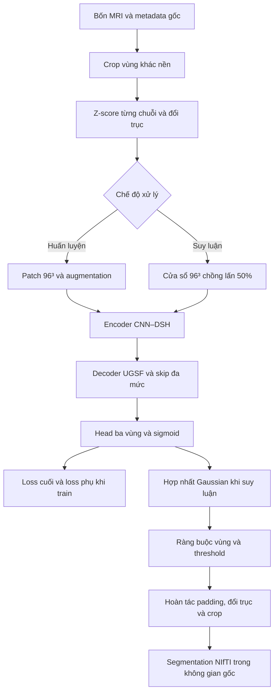

# DAU-Mamba: Kiến trúc phân đoạn u não 3D

**Direction-Adaptive and Uncertainty-Guided CNN–Mamba**  
**Đặc tả từ dữ liệu MRI đầu vào, tiền xử lý và tổ chức đặc trưng đến suy luận và xuất segmentation.**

> **Trạng thái:** thiết kế kiến trúc đề xuất. Pipeline dữ liệu kế thừa dự án BraTS hiện tại; DSH, UGSF và cấu hình mạng được đặc tả dưới đây là phần mở rộng cần triển khai và thực nghiệm. Tài liệu không gán kết quả của checkpoint U-Net/TransUNet hiện có cho DAU-Mamba.

## 1. Mục tiêu và phạm vi kiến trúc

DAU-Mamba nhận bốn thể tích MRI của cùng một bệnh nhân và dự đoán ba vùng u não: Whole Tumor (WT), Tumor Core (TC) và Enhancing Tumor (ET). Mô hình sử dụng encoder–decoder hình chữ U, kết hợp CNN ở độ phân giải cao với Mamba đa hướng ở các tầng sâu. Các skip connection được điều khiển bằng tín hiệu entropy từ dự đoán phụ của decoder.

Hai thành phần custom chính là:

1. **DSH — Direction-Adaptive Split Hybrid Block:** chia kênh thành nhánh CNN cục bộ và nhánh Mamba đa hướng; học trọng số để kết hợp các hướng quét theo từng đầu vào.
2. **UGSF — Uncertainty-Guided Skip Fusion:** dùng đặc trưng encoder, đặc trưng decoder và entropy của dự đoán phụ để học cổng kết hợp skip theo từng kênh và từng voxel.

Mạng không sử dụng query Transformer decoder của cấu hình TransUNet đã train. Mamba được bố trí trong encoder; đầu ra được tạo bằng convolution toàn phân giải sau decoder.

## 2. Quy ước ký hiệu và cấu hình thiết kế

| Ký hiệu | Ý nghĩa |
|---|---|
| $B$ | Kích thước batch |
| $C$ | Số kênh đặc trưng tại một tầng |
| $(x,y,z)$ | Chỉ số ba trục của mảng NIfTI được đọc ban đầu |
| $(d,h,w)$ | Chỉ số ba trục trong tensor đưa vào mạng |
| $u$ | Một vị trí voxel |
| $E_i$ | Đặc trưng encoder ở mức $i$ |
| $F_i^{dec}$ | Đặc trưng đầu ra decoder ở mức $i$ |
| $V_i$ | Đặc trưng decoder đã chiếu kênh và upsample |
| $U_i$ | Bản đồ entropy một kênh tại mức decoder $i$ |
| $G_i$ | Cổng kết hợp encoder–decoder |
| $Z$ | Logits, trước sigmoid |
| $P$ | Xác suất, sau sigmoid |
| $\odot$ | Phép nhân từng phần tử |
| $[A,B]$ | Ghép tensor theo chiều kênh |
| $\sigma$ | Hàm sigmoid |
| $\phi$ | LeakyReLU, hệ số âm $0{,}01$ |

**Cấu hình tham chiếu của thiết kế:**

| Thành phần | Lựa chọn |
|---|---|
| Không gian xử lý | 3D |
| Số kênh đầu vào | 4: T1, T1ce, T2, FLAIR |
| Patch / cửa sổ suy luận | $96\times96\times96$ |
| Kênh encoder | $[32,64,128,256,320]$ |
| Số mức downsample | 4, hệ số tổng cộng 16 |
| Vị trí DSH | E2, E3 và bottleneck |
| Số DSH mỗi mức | 1 |
| Tỷ lệ chia kênh trong DSH | $1:1$ |
| Hướng Mamba | Thuận, đảo ngược và liên lát cắt |
| Tham số giữa ba nhánh Mamba | Độc lập |
| Trọng số hướng | Một bộ ba cho mỗi mẫu tại mỗi DSH |
| Số mức UGSF | 4: D3, D2, D1, D0 |
| Upsampling decoder | Convolution $1^3$ rồi nội suy trilinear |
| Chuẩn hóa CNN | Instance Normalization có affine |
| Chuẩn hóa trước Mamba | Layer Normalization theo chiều kênh |
| Kích hoạt CNN | LeakyReLU với hệ số âm $0{,}01$ |
| Đầu ra | 3 logits, sigmoid độc lập |
| Chồng lấn cửa sổ suy luận | $0{,}5$ |
| Hợp nhất cửa sổ | Trọng số Gaussian |
| Ngưỡng nhị phân | $0{,}5$ cho cả ba vùng |

Các kích thước trên xác định kiến trúc tham chiếu, không phải cấu hình đã được chứng minh tối ưu về Dice hoặc VRAM.

## 3. Dữ liệu đầu vào và thông tin hình học

### 3.1. Bốn chuỗi MRI

Mỗi ca gồm các tệp NIfTI của cùng một bệnh nhân:

| Kênh | Tệp điển hình | Nội dung |
|---|---|---|
| 0 | `*_t1.nii.gz` | T1-weighted |
| 1 | `*_t1ce.nii.gz` | T1 có tương phản |
| 2 | `*_t2.nii.gz` | T2-weighted |
| 3 | `*_flair.nii.gz` | FLAIR |
| Nhãn huấn luyện | `*_seg.nii.gz` | Segmentation tham chiếu |

Điều kiện đầu vào là bốn chuỗi đã được đưa về cùng lưới voxel và cùng hệ tọa độ. Pipeline này sử dụng dữ liệu BraTS đã chuẩn bị; không bổ sung một mạng registration hoặc skull stripping mới.

Ảnh được ghép theo chiều kênh:

$$
X_{raw}=\operatorname{Stack}(X_{T1},X_{T1ce},X_{T2},X_{FLAIR})
\in\mathbb R^{4\times X_0\times Y_0\times Z_0}.
$$

Trước khi xử lý, kiểm tra bốn chuỗi có cùng kích thước, cùng lưới không gian, giá trị hữu hạn và có vùng ảnh khác 0. Nhãn, khi có, phải cùng lưới với ảnh và thuộc tập $\{0,1,2,4\}$.

### 3.2. Phân chia bệnh nhân

Việc chia train, validation và test được thực hiện theo **bệnh nhân trước khi lấy patch**. Các patch của cùng bệnh nhân chỉ thuộc một tập dữ liệu. Khi tiếp tục thiết lập 200 ca của dự án, có thể giữ split 140 train / 30 validation / 30 test để duy trì cùng danh sách bệnh nhân.

### 3.3. Metadata cần giữ lại

| Metadata | Mục đích |
|---|---|
| Mã bệnh nhân | Liên kết ảnh, nhãn và đầu ra |
| `orig_shape` | Khôi phục kích thước mảng NIfTI ban đầu |
| Affine $4\times4$ và header cần thiết | Giữ tọa độ vật lý, hướng ảnh và voxel spacing khi xuất |
| Bounding box crop | Đặt dự đoán vào đúng vị trí trong ảnh gốc |
| Phép đổi thứ tự trục | Hoàn tác trước khi xuất |
| Số voxel padding ở mỗi phía | Loại bỏ đúng phần padding khi suy luận |

Trong tài liệu này, quy ước tensor mạng là $(C,D,H,W)$ với $(D,H,W)=(Z,X,Y)$. Đây là phép hoán vị trục của mảng, không phải resampling hay thay đổi tọa độ vật lý. Nhãn phải được đổi trục giống ảnh; đầu ra phải được đổi ngược trước khi sử dụng affine gốc.

## 4. Tiền xử lý thể tích

### 4.1. Tạo mặt nạ vùng ảnh và crop

Từ ảnh thô, xác định hợp các voxel khác 0 trên bốn kênh:

$$
M(u)=\bigvee_{c=1}^{4}[X_{raw,c}(u)\ne0].
$$

Lấy bounding box nhỏ nhất bao quanh $M$ theo ba trục của mảng gốc. Với cấu hình tham chiếu, margin bằng 0. Crop cùng bounding box cho cả bốn ảnh và nhãn; lưu các cận dưới, cận trên theo quy ước cận trên không bao gồm voxel cuối.

Mặt nạ này là quy tắc tìm vùng ảnh khác nền, không phải một dự đoán giải phẫu mới. Đối với dữ liệu đã loại bỏ hộp sọ, nó giúp loại bớt nền 0 và giảm phạm vi cần xử lý.

### 4.2. Z-score riêng từng chuỗi

Với kênh $c$, đặt $\Omega_c=\{u:X_c(u)\ne0\}$. Tính thống kê trên vùng này của **toàn thể tích đã crop**, trước khi lấy patch:

$$
\mu_c=\frac{1}{|\Omega_c|}\sum_{u\in\Omega_c}X_c(u),
\qquad
\sigma_c=\sqrt{\frac{1}{|\Omega_c|}\sum_{u\in\Omega_c}(X_c(u)-\mu_c)^2}.
$$

Chuẩn hóa:

$$
\widehat X_c(u)=
\begin{cases}
\dfrac{X_c(u)-\mu_c}{\sigma_c+\varepsilon_n},&u\in\Omega_c,\\[5pt]
0,&u\notin\Omega_c,
\end{cases}
\qquad \varepsilon_n=10^{-8}.
$$

Mỗi chuỗi có thống kê riêng; không trộn cường độ của bốn chuỗi để tính một trung bình chung. Kênh không có voxel khác 0 được giữ bằng 0. Không sử dụng thống kê từ ảnh test để điều chỉnh tham số của các ca train.

### 4.3. Chuyển nhãn sang ba vùng lồng nhau

Nhãn gốc được chuyển thành:

$$
Y_{WT}(u)=\mathbb1[S(u)\in\{1,2,4\}],
$$

$$
Y_{TC}(u)=\mathbb1[S(u)\in\{1,4\}],
\qquad
Y_{ET}(u)=\mathbb1[S(u)=4].
$$

Ghép theo thứ tự cố định WT, TC, ET. Ảnh có kiểu `float32`; nhãn nhị phân có thể lưu `uint8` và chuyển sang số thực khi tính loss.

### 4.4. Sắp xếp trục và padding

Sau crop và chuẩn hóa, chuyển ảnh từ $(4,X_c,Y_c,Z_c)$ sang $(4,Z_c,X_c,Y_c)$; nhãn được chuyển tương ứng. Chỉ số $c$ trong $X_c,Y_c,Z_c$ ở đây chỉ kích thước sau crop.

Nếu một chiều không đủ 96 voxel, zero-padding đối xứng gần bằng nhau ở hai phía của chiều đó. Với độ thiếu $p$, phía trước nhận $\lfloor p/2\rfloor$ voxel, phía sau nhận phần còn lại. Ảnh và nhãn dùng cùng padding. Thông tin padding được giữ để hoàn tác khi suy luận.

## 5. Lấy mẫu và tăng cường dữ liệu huấn luyện

### 5.1. Patch 3D

Mỗi lần lấy mẫu tạo:

$$
X_p\in\mathbb R^{4\times96\times96\times96},
\qquad
Y_p\in\{0,1\}^{3\times96\times96\times96}.
$$

Với xác suất $0{,}5$, chọn một voxel thuộc WT rồi lấy patch quanh vị trí đó, có dịch chuyển ngẫu nhiên và giới hạn vị trí crop trong thể tích. Với xác suất còn lại, lấy patch ngẫu nhiên. Patch ngẫu nhiên vẫn có thể chứa u. Nếu ca không có voxel WT, sử dụng lấy mẫu ngẫu nhiên.

Không resize toàn bộ não thành $96^3$: $96^3$ là kích thước patch, còn toàn thể tích được giữ ở lưới voxel đầu vào.

### 5.2. Augmentation đề xuất

| Phép biến đổi | Tham số tham chiếu | Áp dụng |
|---|---|---|
| Lật theo từng trục | Xác suất $0{,}5$ mỗi trục | Ảnh và nhãn đồng bộ |
| Scale intensity | Hệ số quanh 1, biên độ $0{,}1$; xác suất $0{,}5$ | Chỉ ảnh |
| Shift intensity | Offset biên độ $0{,}1$; xác suất $0{,}5$ | Chỉ ảnh |
| Gaussian noise | Độ lệch chuẩn $0{,}1$; xác suất $0{,}15$ | Chỉ ảnh |

Đây là cấu hình augmentation đề xuất cho DAU-Mamba. Cấu hình 3D nhỏ đang có trong repository để `augment: {}`, vì vậy không được mô tả các phép trên như augmentation đã chạy của checkpoint 3D.

Sau lấy mẫu và augmentation, ghép batch để tạo $X\in\mathbb R^{B\times4\times96\times96\times96}$. Validation và test không dùng augmentation ngẫu nhiên hoặc nhãn để chọn cửa sổ suy luận.

## 6. Luồng xử lý toàn hệ thống

## 7. Khung encoder–decoder

*Hình 1. Encoder CNN–DSH, decoder UGSF và đầu ra toàn phân giải. Đường nét đứt là skip connection cùng mức không gian.*

### 7.1. Kích thước tensor tại từng mức

| Mức | Phép xử lý | Tensor đầu ra, bỏ chiều batch |
|---|---|---|
| Input | Patch bốn kênh | $4\times96\times96\times96$ |
| E0 | Stem + residual CNN | $32\times96\times96\times96$ |
| E1 | Downsample + residual CNN | $64\times48\times48\times48$ |
| E2 | Downsample + DSH | $128\times24\times24\times24$ |
| E3 | Downsample + DSH | $256\times12\times12\times12$ |
| Bottleneck | Downsample + DSH | $320\times6\times6\times6$ |
| D3 | Chiếu kênh, upsample, UGSF với E3, residual CNN | $256\times12\times12\times12$ |
| D2 | Chiếu kênh, upsample, UGSF với E2, residual CNN | $128\times24\times24\times24$ |
| D1 | Chiếu kênh, upsample, UGSF với E1, residual CNN | $64\times48\times48\times48$ |
| D0 | Chiếu kênh, upsample, UGSF với E0, residual CNN | $32\times96\times96\times96$ |
| Head | Convolution $1^3$, 32 thành 3 kênh | $3\times96\times96\times96$ |

### 7.2. Stem và downsampling

Stem dùng convolution $3\times3\times3$, stride 1, padding 1, chuyển 4 kênh thành 32 kênh; theo sau là Instance Normalization và LeakyReLU. Residual CNN tại E0 tiếp tục xử lý đặc trưng mà không giảm kích thước.

Mỗi downsampling dùng convolution $3\times3\times3$, stride 2, padding 1, đi cùng Instance Normalization và LeakyReLU. Sau bốn lần downsample, kích thước patch giảm từ $96^3$ xuống $6^3$.

### 7.3. Residual CNN

Với đầu vào $F$, đặt:

$$
H=\phi\left(\operatorname{IN}(\operatorname{Conv}_{3^3}^{(1)}(F))\right),
$$

$$
\operatorname{ResCNN}(F)
=\phi\left(\operatorname{Proj}(F)+\operatorname{IN}(\operatorname{Conv}_{3^3}^{(2)}(H))\right).
$$

Hai convolution dùng stride 1, padding 1. $\operatorname{Proj}$ là identity nếu số kênh bằng nhau, hoặc convolution $1^3$ để căn chỉnh số kênh. Instance Normalization có affine; LeakyReLU dùng hệ số âm $0{,}01$.

### 7.4. Phân bổ CNN và Mamba theo độ sâu

E0 và E1 xử lý đặc trưng độ phân giải cao bằng CNN. E2, E3 và bottleneck bổ sung Mamba bằng DSH. Nếu mỗi vị trí không gian tương ứng một token, chiều dài chuỗi lần lượt là:

| Mức DSH | Số token mỗi hướng |
|---|---:|
| E2, $24^3$ | 13.824 |
| E3, $12^3$ | 1.728 |
| Bottleneck, $6^3$ | 216 |

Cách bố trí này giới hạn chiều dài chuỗi so với đặt Mamba trực tiếp tại $96^3$. Các con số trên là số vị trí không gian; không phải phép đo thời gian chạy hoặc mức sử dụng VRAM.

## 8. DSH: khối lai chia kênh thích nghi theo hướng

*Hình 2. Nhánh CNN học thông tin cục bộ; ba nhánh Mamba xử lý các thứ tự quét khác nhau; bộ điều phối học trọng số hướng theo từng mẫu.*

### 8.1. Chia kênh

Cho đầu vào:

$$
F\in\mathbb R^{B\times C\times D\times H\times W}.
$$

Chia kênh thành hai nhóm bằng nhau:

$$
[F_l,F_g]=\operatorname{Split}_{channel}(F),
\qquad
F_l,F_g\in\mathbb R^{B\times(C/2)\times D\times H\times W}.
$$

Tất cả số kênh tại các mức DSH đều chẵn. Phép chia tác động lên kênh đặc trưng đã học, không tách riêng các chuỗi MRI.

### 8.2. Nhánh local CNN

Nhánh local gồm hai convolution $3^3$ giữ nguyên số kênh $C/2$, mỗi lớp đi cùng Instance Normalization và LeakyReLU:

$$
L=\operatorname{CNA}_2(\operatorname{CNA}_1(F_l)),
\qquad
\operatorname{CNA}=\phi\circ\operatorname{IN}\circ\operatorname{Conv}_{3^3}.
$$

Đầu ra $L$ giữ kích thước của $F_l$, cung cấp thông tin lân cận và cấu trúc không gian cục bộ.

### 8.3. Chuẩn hóa và tạo ba chuỗi

Chuẩn hóa $F_g$ theo chiều kênh tại từng voxel:

$$
\overline F_g=\operatorname{LN}_{channel}(F_g).
$$

Đặt $N=DHW$. Mỗi phép quét là một hoán vị một-một của $N$ vị trí, tạo chuỗi kích thước $B\times N\times(C/2)$.

| Hướng | Quy ước chỉ số chuỗi, tính từ 0 |
|---|---|
| Thuận $f$ | $n_f(d,h,w)=(dH+h)W+w$ |
| Đảo ngược $r$ | $n_r(d,h,w)=N-1-n_f(d,h,w)$ |
| Liên lát cắt $s$ | $n_s(d,h,w)=(hW+w)D+d$ |

Theo quy ước này, hướng thuận duyệt nhanh theo $w$; hướng liên lát cắt duyệt nhanh theo $d$ tại từng cặp $(h,w)$. Đây là đặc tả thứ tự token của DAU-Mamba, không đồng nhất ba hướng này với ba mặt phẳng giải phẫu.

### 8.4. Xử lý Mamba và khôi phục tọa độ

Mỗi chuỗi đi qua một nhánh Mamba với tham số độc lập:

$$
M_t=\operatorname{Restore}_t\left(\operatorname{Mamba}_t(\operatorname{Scan}_t(\overline F_g))\right),
\quad t\in\{f,r,s\}.
$$

Cấu hình khởi tạo đề xuất cho mỗi nhánh:

| Thuộc tính | Giá trị |
|---|---|
| Chiều token đầu vào và đầu ra | $d_{model}=C/2$ |
| Kích thước trạng thái | $d_{state}=16$ |
| Hệ số mở rộng bên trong | `expand = 2` |
| Kernel convolution 1D bên trong Mamba | `d_conv = 4` |
| Số module Mamba mỗi hướng trong một DSH | 1 |

Các giá trị trên là siêu tham số khởi tạo của thiết kế. Convolution 1D bên trong Mamba chạy theo thứ tự token; nó không thay thế convolution 3D trong nhánh local.

Ở mức mô tả SSM, trạng thái chuỗi được cập nhật theo dạng:

$$
h_n=\overline A_nh_{n-1}+\overline B_nx_n,
\qquad
y_n=C_nh_n+D_{skip}x_n.
$$

Các đại lượng điều khiển chọn lọc phụ thuộc đầu vào; biểu thức này mô tả thành phần truyền trạng thái, không thay cho toàn bộ các phép chiếu, kích hoạt và gating nội bộ của Mamba.

Sau xử lý, mỗi đầu ra được hoán vị ngược để $M_f,M_r,M_s$ cùng biểu diễn một voxel tại cùng chỉ số $(d,h,w)$. Không cộng các chuỗi khi chúng còn khác thứ tự không gian.

### 8.5. Bộ điều phối hướng

Tính vector toàn cục từ $F_g$:

$$
g_b=\frac{1}{DHW}\sum_{d,h,w}F_{g,b,:,d,h,w}
\in\mathbb R^{C/2}.
$$

MLP gồm hai lớp linear, kích hoạt GELU ở giữa, chiều ẩn $h=\max(8,C/8)$. Softmax cuối tạo trọng số:

$$
[a_{b,f},a_{b,r},a_{b,s}]
=\operatorname{softmax}(W_2\operatorname{GELU}(W_1g_b+b_1)+b_2).
$$

Với mỗi mẫu $b$:

$$
\sum_{t\in\{f,r,s\}}a_{b,t}=1,
\qquad a_{b,t}>0.
$$

Broadcast trọng số trên kênh và không gian để tổng hợp:

$$
M_b=a_{b,f}M_{b,f}+a_{b,r}M_{b,r}+a_{b,s}M_{b,s}.
$$

Trọng số thay đổi theo mẫu và theo block, nhưng không thay đổi theo từng voxel trong cùng một block. Cả ba nhánh Mamba vẫn chạy; cơ chế này điều chỉnh đóng góp đặc trưng, không thực hiện bỏ nhánh tính toán.

### 8.6. Channel shuffle, projection và residual

Ghép đặc trưng:

$$
F_{cat}=[L,M]\in\mathbb R^{B\times C\times D\times H\times W}.
$$

Channel shuffle hai nhóm thực hiện reshape theo nhóm, hoán đổi chiều nhóm và chiều kênh con, rồi khôi phục $C$ kênh. Convolution $1^3$ tiếp tục học cách phối hợp kênh:

$$
H_{mix}=\operatorname{Conv}_{1^3}(\operatorname{Shuffle}_2(F_{cat})),
$$

$$
\boxed{F_{out}=F+H_{mix}.}
$$

DSH giữ nguyên kích thước tensor và có đường residual trực tiếp. Phần thích nghi theo hướng là thay đổi chính so với cách kết hợp các hướng bằng trọng số cố định.

## 9. Decoder: khôi phục độ phân giải

Decoder đi từ bottleneck tới D3, D2, D1 và D0. Ở mỗi mức, chiếu kênh trước rồi upsample:

$$
V_i=\operatorname{Interp}_{tri}\left(\operatorname{Conv}_{1^3}(F_{i+1}^{dec}),\operatorname{size}(E_i)\right).
$$

Với D3, $F_{i+1}^{dec}$ được thay bằng đặc trưng bottleneck. Nội suy dùng `align_corners = false` và lấy kích thước đích trực tiếp từ skip encoder để tránh lệch kích thước.

| Mức decoder | Đầu vào sâu | Chiếu kênh | Kích thước sau nội suy | Skip |
|---|---|---|---|---|
| D3 | $320\times6^3$ | $320\rightarrow256$ | $256\times12^3$ | E3 |
| D2 | $256\times12^3$ | $256\rightarrow128$ | $128\times24^3$ | E2 |
| D1 | $128\times24^3$ | $128\rightarrow64$ | $64\times48^3$ | E1 |
| D0 | $64\times48^3$ | $64\rightarrow32$ | $32\times96^3$ | E0 |

Mỗi skip được chiếu bởi convolution $1^3$ để tạo $E_i'$ cùng số kênh với $V_i$. Hai tensor được đưa vào UGSF thay cho phép cộng hoặc ghép skip cố định.

## 10. UGSF: kết hợp skip có hướng dẫn bởi entropy

*Hình 3. Dự đoán phụ từ decoder tạo entropy; cổng sử dụng đồng thời entropy và hai nguồn đặc trưng để quyết định phép trộn.*

### 10.1. Auxiliary region head

Tại mức $i$, convolution $1^3$ ánh xạ $C_i$ kênh của $V_i$ thành ba logits:

$$
Z_i=\operatorname{AuxHead}_i(V_i)
\in\mathbb R^{B\times3\times d_i\times h_i\times w_i}.
$$

Sigmoid tạo xác suất vùng:

$$
P_i=\sigma(Z_i).
$$

Auxiliary head dùng đặc trưng decoder **trước fusion**, vì vậy luồng tính không có vòng phụ thuộc: $V_i\rightarrow P_i\rightarrow U_i\rightarrow G_i\rightarrow F_i^{dec}$.

### 10.2. Entropy nhị phân theo voxel

Chặn xác suất:

$$
\overline P_i=\operatorname{clip}(P_i,\varepsilon_u,1-\varepsilon_u),
\qquad\varepsilon_u=10^{-6}.
$$

Tính entropy trung bình trên ba vùng WT, TC, ET:

$$
U_i(u)=-\frac{1}{3\log2}\sum_{k=1}^{3}
\left[\overline P_{ik}(u)\log\overline P_{ik}(u)
+(1-\overline P_{ik}(u))\log(1-\overline P_{ik}(u))\right].
$$

Đầu ra:

$$
U_i\in[0,1]^{B\times1\times d_i\times h_i\times w_i}.
$$

Entropy lớn khi xác suất gần $0{,}5$; nhỏ khi gần 0 hoặc 1. Một dự đoán sai nhưng quá tự tin vẫn có thể có entropy thấp. Vì vậy, $U_i$ được sử dụng như tín hiệu bổ sung để học fusion, không phải bản đồ bảo đảm độ chính xác.

### 10.3. Cổng không gian–kênh

Căn chỉnh skip:

$$
E_i'=\operatorname{Conv}_{1^3}(E_i),
\qquad
E_i',V_i\in\mathbb R^{B\times C_i\times d_i\times h_i\times w_i}.
$$

Ghép các nguồn:

$$
Q_i=[E_i',V_i,U_i]
\in\mathbb R^{B\times(2C_i+1)\times d_i\times h_i\times w_i}.
$$

Convolution $1^3$ tạo $C_i$ kênh, theo sau là sigmoid:

$$
G_i=\sigma\left(\operatorname{Conv}_{1^3}^{(2C_i+1)\rightarrow C_i}(Q_i)\right).
$$

Cổng có cùng kích thước với $E_i'$ và $V_i$. Khi $G_i$ gần 1, đặc trưng encoder đóng góp nhiều hơn; khi gần 0, đặc trưng decoder đóng góp nhiều hơn.

### 10.4. Fusion và refinement

$$
S_i=G_i\odot E_i'+(1-G_i)\odot V_i,
$$

$$
\boxed{F_i^{dec}=\operatorname{ResCNN}(S_i).}
$$

UGSF học cách sử dụng chi tiết encoder cùng ngữ cảnh decoder. Không áp đặt rằng entropy cao phải giảm skip, bởi vùng biên hoặc tổn thương nhỏ cũng có thể tạo entropy cao.

Mặc dù fusion cuối là tổng có trọng số, UGSF vẫn ghép tensor để tính cổng. Thiết kế không loại bỏ hoàn toàn concat và chưa xác định được mức chênh lệch tham số hoặc VRAM so với các decoder khác.

### 10.5. Hoạt động khi suy luận

Các auxiliary head vẫn được tính khi suy luận vì entropy của chúng là đầu vào của cổng. Không cần xuất mask phụ cho người dùng; chỉ phép tính auxiliary loss được loại bỏ.

## 11. Head phân đoạn cuối

Từ đặc trưng toàn phân giải:

$$
F_0^{dec}\in\mathbb R^{B\times32\times96\times96\times96},
$$

head tạo logits:

$$
Z_{final}=\operatorname{Conv}_{1^3}^{32\rightarrow3}(F_0^{dec}).
$$

Sigmoid độc lập tạo:

$$
P_{patch}=\sigma(Z_{final})
\in[0,1]^{B\times3\times96\times96\times96}.
$$

Thứ tự kênh là WT, TC, ET. Không áp dụng softmax trên ba kênh này vì một voxel ET đồng thời thuộc TC và WT.

## 12. Giám sát đầu ra cuối và các đầu ra phụ

### 12.1. Loss vùng

Với logits $Z$ và nhãn $Y$, dùng BCE trên logits kết hợp soft Dice:

$$
\mathcal L_{seg}(Z,Y)
=\mathcal L_{BCEWithLogits}(Z,Y)+\mathcal L_{Dice}(\sigma(Z),Y).
$$

Trong đặc tả này, Dice được tính theo từng mẫu và từng vùng rồi lấy trung bình:

$$
\mathcal L_{Dice}(P,Y)
=1-\frac{1}{3B}\sum_{b=1}^{B}\sum_{k=1}^{3}
\frac{2\sum_uP_{bk}(u)Y_{bk}(u)+\varepsilon_d}
{\sum_uP_{bk}(u)+\sum_uY_{bk}(u)+\varepsilon_d},
\qquad\varepsilon_d=10^{-5}.
$$

Đây là lựa chọn reduction của thiết kế; cần giữ nhất quán trong các thực nghiệm của DAU-Mamba.

### 12.2. Deep supervision

Nội suy **logits** phụ lên $96^3$ trước khi tính loss:

$$
\widetilde Z_i=\operatorname{Interp}_{tri}(Z_i,96^3).
$$

Loss toàn mạng:

$$
\boxed{\mathcal L
=\mathcal L_{seg}(Z_{final},Y_p)
+\sum_{i=0}^{3}\lambda_i\mathcal L_{seg}(\widetilde Z_i,Y_p).}
$$

Các $\lambda_i\ge0$ là siêu tham số huấn luyện cần chọn bằng validation, không phải giá trị đã tối ưu. Loss phụ cung cấp mục tiêu phân đoạn trực tiếp cho các head tạo entropy. Loss được tính trên logits thô, trước ràng buộc cumulative max và trước nhị phân hóa.

### 12.3. Đường truyền gradient

Thiết kế tham chiếu huấn luyện end-to-end: gradient từ đầu ra cuối có thể truyền qua fusion, cổng, entropy và auxiliary head. Các loss phụ đồng thời tác động trực tiếp lên logits phụ. Không có thao tác detach hoặc đóng băng một nhánh được mặc định trong đặc tả này.

## 13. Suy luận trên toàn thể tích

### 13.1. Tiền xử lý khi suy luận

Chỉ cần bốn chuỗi MRI và metadata; không cần segmentation tham chiếu. Áp dụng cùng crop, chuẩn hóa, đổi trục và padding như khi chuẩn bị dữ liệu huấn luyện. Thống kê z-score được tính riêng từ chính ảnh cần dự đoán.

### 13.2. Sliding-window inference

Dùng cửa sổ $96\times96\times96$ với overlap $0{,}5$. Với cửa sổ đầy đủ, bước dịch danh định là 48 voxel theo mỗi chiều; cửa sổ cuối được căn chỉnh để phủ hết biên của thể tích. Mỗi cửa sổ đi qua toàn bộ encoder, DSH, decoder, UGSF và head cuối.

Việc lấy cửa sổ không sử dụng nhãn hoặc vị trí u thật. Batch cửa sổ có thể thay đổi theo bộ nhớ, nhưng không làm thay đổi các chiều đặc trưng của mạng.

### 13.3. Hợp nhất xác suất bằng Gaussian

Gọi $\Omega_j$ là cửa sổ thứ $j$, $P_{j,k}(u)$ là xác suất vùng $k$ của cửa sổ đó tại vị trí toàn cục $u$. Hợp nhất:

$$
P_k(u)=
\frac{\sum_{j:u\in\Omega_j}w_j(u)P_{j,k}(u)}
{\sum_{j:u\in\Omega_j}w_j(u)+\varepsilon}.
$$

$w_j(u)$ là trọng số Gaussian dương, lớn hơn gần tâm cửa sổ và nhỏ hơn gần biên. Hợp nhất xác suất trước khi threshold; không bỏ phiếu trên các mask nhị phân riêng lẻ.

Kết quả có kích thước bằng thể tích đã padding. Loại bỏ padding theo metadata để thu lại vùng crop thực tế.

## 14. Hậu xử lý ba vùng và chuyển về nhãn BraTS

### 14.1. Áp đặt quan hệ xác suất

Với các xác suất sau hợp nhất:

$$
\widetilde P_{ET}=P_{ET},
$$

$$
\widetilde P_{TC}=\max(P_{TC},\widetilde P_{ET}),
$$

$$
\widetilde P_{WT}=\max(P_{WT},\widetilde P_{TC}).
$$

Phép max được thực hiện theo từng voxel, tạo quan hệ:

$$
\widetilde P_{WT}\ge\widetilde P_{TC}\ge\widetilde P_{ET}.
$$

Đây là bước hậu xử lý kế thừa pipeline hiện tại, không phải một thành phần mới của DSH hoặc UGSF.

### 14.2. Nhị phân hóa

Dùng cùng ngưỡng $\tau=0{,}5$:

$$
R_k(u)=\mathbb1[\widetilde P_k(u)>\tau].
$$

Khi đó:

$$
R_{ET}\subseteq R_{TC}\subseteq R_{WT}.
$$

### 14.3. Tạo bản đồ nhãn rời rạc

$$
\widehat S(u)=
\begin{cases}
4,&u\in R_{ET},\\
1,&u\in R_{TC}\setminus R_{ET},\\
2,&u\in R_{WT}\setminus R_{TC},\\
0,&u\notin R_{WT}.
\end{cases}
$$

Nhãn 2 tương ứng phần WT ngoài TC; nhãn 1 tương ứng phần TC ngoài ET; nhãn 4 tương ứng ET. Không áp dụng loại bỏ tổn thương nhỏ hoặc lọc connected component như một bước mặc định của thiết kế.

## 15. Khôi phục hình học và output

### 15.1. Hoàn tác biến đổi không gian

Thực hiện đúng thứ tự:

1. Loại bỏ padding của thể tích đã dùng trong suy luận.
2. Đổi trục từ $(D,H,W)=(Z,X,Y)$ về $(X,Y,Z)$.
3. Tạo mảng kích thước gốc $(X_0,Y_0,Z_0)$ với nền bằng 0.
4. Đặt dự đoán vào đúng bounding box đã lưu.
5. Gắn affine và thông tin hình học phù hợp của ảnh gốc khi lưu NIfTI.

Không dùng trực tiếp affine gốc cho mảng vẫn còn ở thứ tự trục của mạng. Với pipeline chỉ crop, padding và hoán vị trục như trên, không cần nội suy ngược để khôi phục lưới gốc.

### 15.2. Các đầu ra

| Đầu ra | Kích thước theo lưới gốc | Kiểu dữ liệu | Nội dung |
|---|---|---|---|
| Xác suất vùng | $3\times X_0\times Y_0\times Z_0$ | `float32` | WT, TC, ET; cần ghi rõ là trước hay sau cumulative max |
| Mask vùng | $3\times X_0\times Y_0\times Z_0$ | `uint8` | Ba vùng nhị phân lồng nhau |
| Segmentation | $X_0\times Y_0\times Z_0$ | `uint8` | Nhãn $\{0,1,2,4\}$ |
| Tệp NIfTI | Hình học ảnh gốc | `.nii.gz` | Segmentation kèm affine và voxel spacing |

Nếu xuất xác suất dùng cho kết quả cuối, tài liệu này chọn bản đã áp đặt quan hệ lồng nhau $\widetilde P$. Các xác suất trước hậu xử lý có thể lưu riêng để phân tích, với tên phân biệt rõ.

Ảnh overlay được tạo bằng cách tô màu segmentation trên MRI ở các lát cắt tương ứng. Overlay là hình thức hiển thị đầu ra, không phải một nhánh của mạng và không làm thay đổi dự đoán.

## 16. Phần kế thừa và phần custom

| Thành phần | Cơ sở kế thừa | Lựa chọn trong DAU-Mamba |
|---|---|---|
| Đọc bốn MRI, crop và z-score | Pipeline BraTS của repository hiện tại | Giữ nguyên nguyên tắc, đặc tả thêm quy ước trục và metadata |
| Nhãn WT/TC/ET | Pipeline hiện tại | Ba bài toán nhị phân lồng nhau |
| Encoder–decoder CNN–SSM | Ý tưởng kết hợp CNN và Mamba của U-Mamba | CNN ở tầng nông, DSH ở tầng sâu |
| Chia nhánh CNN–SSM và shuffle | Cấu trúc SS-Conv-SSM của MedMamba | Chuyển sang đặc trưng 3D và dùng Mamba ba thứ tự quét |
| Mamba đa hướng | Ý tưởng ToM của SegMamba | Đặc tả ba hoán vị và thêm trọng số hướng theo đầu vào |
| Skip có tín hiệu bất định | Ý tưởng FUE của SegMamba | Dùng entropy nhị phân từ dự đoán phụ có giám sát và cổng hai nguồn |
| Decoder nội suy và chiếu kênh | Hướng thiết kế decoder của SegResMamba | Dùng UGSF và residual CNN sau mỗi lần upsample |
| Sliding window và Gaussian blending | Pipeline suy luận 3D hiện tại | Cửa sổ $96^3$, overlap $0{,}5$ |
| Quan hệ lồng nhau và uncrop | Pipeline hiện tại | Giữ cumulative max và khôi phục NIfTI |

**Đóng góp cấu trúc được đề xuất:** (1) DSH kết hợp các nhánh Mamba bằng trọng số hướng phụ thuộc mẫu; (2) UGSF điều kiện hóa phép trộn encoder–decoder bằng entropy của auxiliary prediction. Các thành phần CNN, Mamba, residual, channel shuffle và khung U-shaped là thành phần kế thừa. Tài liệu chưa xác lập tính mới so với toàn bộ công trình liên quan.

FUE trong bản SegMamba được cung cấp tính tín hiệu từ đặc trưng encoder trung bình theo kênh rồi sigmoid; UGSF ở đây sử dụng xác suất vùng từ auxiliary head có giám sát và entropy nhị phân đầy đủ. Hai cơ chế không được mô tả như cùng một module.

MedMamba là nghiên cứu phân loại ảnh; kiến trúc này chỉ tiếp thu cách tổ chức khối. SegResMamba được tham chiếu theo bản arXiv ngày 10/03/2025, dù tên tệp được cung cấp chứa năm 2024.

## 17. Nguồn đối chiếu kiến trúc

### 17.1. Dự án hiện tại

- [Repository huấn luyện HK7-CV-Class](https://github.com/nhatminh65537/HK7-CV-Class).
- [Repository demo Brain_Tumor_segmentation](https://github.com/Phucluu2809/Brain_Tumor_segmentation).
- Mốc mã nguồn huấn luyện đã đối chiếu: `ded686669682f9f148e62c607b6969feaeee02a1`.
- [`preprocess.py`: crop, chuẩn hóa, chuyển vùng và uncrop](https://github.com/nhatminh65537/HK7-CV-Class/blob/ded686669682f9f148e62c607b6969feaeee02a1/brats-transunet/src/brats/preprocess.py).
- [`datasets.py`: padding, lấy mẫu patch và augmentation](https://github.com/nhatminh65537/HK7-CV-Class/blob/ded686669682f9f148e62c607b6969feaeee02a1/brats-transunet/src/brats/datasets.py).
- [`inference.py`: sliding-window inference và ràng buộc vùng](https://github.com/nhatminh65537/HK7-CV-Class/blob/ded686669682f9f148e62c607b6969feaeee02a1/brats-transunet/src/brats/inference.py).

### 17.2. Các bài đã cung cấp

1. **U-Mamba: Enhancing Long-range Dependency for Biomedical Image Segmentation.** Bản arXiv v1, 2024. [arXiv:2401.04722v1](https://arxiv.org/abs/2401.04722v1). Cơ sở tham khảo: kết hợp CNN–SSM trong mạng phân đoạn hình chữ U.
2. **MedMamba.** Bản arXiv v5, 2024. [arXiv:2403.03849v5](https://arxiv.org/abs/2403.03849v5). Cơ sở tham khảo: SS-Conv-SSM, chia kênh, ghép nhánh và channel shuffle; mục 3.2.3.
3. **SegMamba: Long-range Sequential Modeling Mamba for 3D Medical Image Segmentation.** Bản arXiv v4, 2024. [arXiv:2401.13560v4](https://arxiv.org/abs/2401.13560v4). Cơ sở tham khảo: ToM và FUE; mục 2.1–2.2.
4. **SegResMamba.** Bản arXiv v1, 2025. [arXiv:2503.07766v1](https://arxiv.org/abs/2503.07766v1). Cơ sở tham khảo: tổ chức encoder–decoder và decoder dùng chiếu kênh, nội suy, kết hợp skip; mục 2.1–2.2.

Các nguồn trên giải thích xuất phát điểm của thiết kế. Kích thước kênh, phân bổ DSH, quy ước trục, trọng số hướng, UGSF và các siêu tham số được ghi là lựa chọn thiết kế của DAU-Mamba, không được quy toàn bộ cho một bài nguồn.
