# BÁO CÁO HỌC PHẦN THỊ GIÁC MÁY TÍNH

## PHÂN ĐOẠN KHỐI U NÃO TRÊN ẢNH MRI ĐA CHUỖI XUNG

### Thực nghiệm U-Net, TransUNet và đề xuất kiến trúc DAU-Mamba

| Thông tin | Nội dung |
|---|---|
| Trường/Khoa | `[Điền tên trường và khoa]` |
| Học phần | Thị giác máy tính |
| Giảng viên hướng dẫn | `[Điền tên giảng viên]` |
| Nhóm thực hiện | `[Điền tên nhóm]` |
| Thành viên | `[Điền họ tên và mã sinh viên]` |
| Địa điểm, thời gian | Đà Nẵng, 10/2026 |

> **Ghi chú về phạm vi khoa học:** U-Net 2D và TransUNet 2D là hai mô hình đã
> được cài đặt, huấn luyện và đánh giá. DAU-Mamba và CGR-Mamba là các kiến trúc
> đề xuất, hiện chưa có checkpoint hoặc kết quả thực nghiệm. Báo cáo luôn tách
> riêng hai nhóm nội dung này để không gán kết quả của mô hình đã chạy cho mô
> hình mới chỉ tồn tại ở mức thiết kế.

---

# LỜI MỞ ĐẦU

U thần kinh đệm là một trong những dạng tổn thương phức tạp của hệ thần kinh
trung ương. Việc xác định chính xác vị trí, kích thước và các tiểu vùng của khối
u trên ảnh cộng hưởng từ có ý nghĩa quan trọng trong chẩn đoán, lập kế hoạch
phẫu thuật, xạ trị và theo dõi đáp ứng điều trị. Trong thực hành lâm sàng, bác sĩ
thường phải quan sát đồng thời nhiều chuỗi xung MRI và khoanh vùng tổn thương
trên từng lát cắt. Công việc này đòi hỏi chuyên môn cao, tốn thời gian và có thể
xuất hiện sai khác giữa những người thực hiện.

Sự phát triển của học sâu mở ra khả năng tự động hóa một phần quy trình trên.
U-Net và các biến thể encoder–decoder đã trở thành nền tảng quan trọng của phân
đoạn ảnh y khoa nhờ khả năng kết hợp đặc trưng ngữ nghĩa với chi tiết không
gian. Tuy nhiên, tích chập chủ yếu mô hình hóa quan hệ cục bộ. Transformer giải
quyết hạn chế này bằng self-attention nhưng có chi phí bậc hai theo số token,
gây khó khăn khi xử lý thể tích MRI 3D. Gần đây, Selective State Space Model,
đại diện bởi Mamba, cho phép mô hình hóa chuỗi dài với độ phức tạp tuyến tính và
được xem là một hướng tiềm năng cho ảnh y khoa có độ phân giải lớn.

Trong khuôn khổ học phần Thị giác máy tính, nhóm thực hiện đề tài “Phân đoạn
khối u não trên ảnh MRI đa chuỗi xung”. Đề tài xây dựng pipeline từ dữ liệu
NIfTI đến mặt nạ WT, TC và ET; tái hiện U-Net 2D và TransUNet 2D trên một tập con
BraTS 2021; đánh giá bằng Dice và HD95; đồng thời xây dựng giao diện Streamlit
để minh họa kết quả. Trên cơ sở khảo sát U-Mamba, MedMamba, SegMamba và
SegResMamba, nhóm đề xuất kiến trúc DAU-Mamba kết hợp CNN cục bộ, Mamba đa
hướng và cổng skip connection dựa trên độ bất định.

Nhóm xin chân thành cảm ơn giảng viên hướng dẫn đã cung cấp kiến thức nền tảng,
định hướng phương pháp nghiên cứu và đóng góp ý kiến trong quá trình thực hiện.
Do giới hạn về dữ liệu, phần cứng và thời gian, báo cáo khó tránh khỏi thiếu
sót. Nhóm mong nhận được góp ý để tiếp tục hoàn thiện hệ thống và kiểm chứng
kiến trúc đề xuất trong các nghiên cứu tiếp theo.

---

# MỤC LỤC

- Lời mở đầu
- Danh mục hình ảnh
- Danh mục bảng biểu
- Danh mục từ viết tắt
- Bảng phân công nhiệm vụ
- Tóm tắt đề tài
- Chương 1. Tổng quan và bối cảnh bài toán
- Chương 2. Thiết kế kiến trúc quy trình xử lý
- Chương 3. Cơ sở lý thuyết và kiến trúc đề xuất DAU-Mamba
- Chương 4. Thực nghiệm, kết quả và so sánh
- Chương 5. Kết luận và phát triển
- Tài liệu tham khảo
- Phụ lục

---

# DANH MỤC HÌNH ẢNH

| Số hiệu | Tên hình | Vị trí gợi ý trong Word |
|---|---|---|
| Hình 1.1 | Bốn chuỗi xung MRI và ground truth của một ca BraTS | Mục 1.1.1 |
| Hình 2.1 | Luồng xử lý end-to-end sáu giai đoạn | Mục 2.1 |
| Hình 2.2 | Cơ chế chuyển nhãn BraTS thành WT, TC và ET | Mục 2.2 |
| Hình 2.3 | Sơ đồ U-Net 2D và skip connection | Mục 2.3.1 |
| Hình 2.4 | Transformer decoder coarse-to-fine với query học được | Mục 2.3.2 |
| Hình 3.1 | Từ thể tích 3D đến selective scan đa hướng | Mục 3.1.4 |
| Hình 3.2 | Kiến trúc tổng thể DAU-Mamba | Mục 3.2 |
| Hình 3.3 | Khối Direction-Adaptive Split Hybrid | Mục 3.3 |
| Hình 3.4 | Khối Uncertainty-Guided Skip Fusion | Mục 3.4 |
| Hình 4.1 | Đường cong huấn luyện U-Net và TransUNet | Mục 4.2 |
| Hình 4.2 | So sánh định tính hai mô hình trên cùng ca test 00088 | Mục 4.3 |

> Toàn bộ hình đã được lưu riêng trong `knowledge/assets`. Script tái tạo hình
> nằm tại `knowledge/scripts/generate_report_figures.py`.

---

# DANH MỤC BẢNG BIỂU

| Số hiệu | Tên bảng |
|---|---|
| Bảng 1.1 | Vai trò của bốn chuỗi xung MRI |
| Bảng 1.2 | Phân hoạch 200 ca BraTS 2021 |
| Bảng 1.3 | Biểu diễn ba vùng u lồng nhau |
| Bảng 2.1 | Sáu giai đoạn của pipeline |
| Bảng 2.2 | So sánh U-Net 2D và TransUNet 2D |
| Bảng 3.1 | Nguồn ý tưởng của DAU-Mamba |
| Bảng 3.2 | Kích thước tensor trong DAU-Mamba |
| Bảng 3.3 | So sánh DAU-Mamba và CGR-Mamba |
| Bảng 4.1 | Cấu hình phần cứng và phần mềm |
| Bảng 4.2 | Siêu tham số huấn luyện |
| Bảng 4.3 | Kết quả validation |
| Bảng 4.4 | Dice trên 30 ca test |
| Bảng 4.5 | HD95 trên 30 ca test |
| Bảng 4.6 | Kết quả ca demo BraTS2021_00495 |
| Bảng 4.7 | Tham số, checkpoint và thời gian huấn luyện |
| Bảng 5.1 | Kế hoạch ablation DAU-Mamba |

---

# DANH MỤC TỪ VIẾT TẮT

| Từ viết tắt | Thuật ngữ tiếng Anh | Ý nghĩa tiếng Việt |
|---|---|---|
| AMP | Automatic Mixed Precision | Tính toán hỗn hợp FP16/FP32 |
| BCE | Binary Cross-Entropy | Entropy chéo nhị phân |
| CNN | Convolutional Neural Network | Mạng nơ-ron tích chập |
| DSC | Dice Similarity Coefficient | Hệ số tương đồng Dice |
| DSH | Direction-Adaptive Split Hybrid | Khối lai chia nhánh thích nghi hướng |
| ET | Enhancing Tumor | Vùng u tăng cường |
| FLAIR | Fluid-Attenuated Inversion Recovery | Chuỗi xung khử tín hiệu dịch não tủy |
| FLOPs | Floating Point Operations | Số phép tính dấu phẩy động |
| HD95 | 95th Percentile Hausdorff Distance | Khoảng cách Hausdorff phân vị 95% |
| MRI | Magnetic Resonance Imaging | Ảnh cộng hưởng từ |
| NIfTI | Neuroimaging Informatics Technology Initiative | Định dạng dữ liệu ảnh thần kinh |
| SSM | State Space Model | Mô hình không gian trạng thái |
| TC | Tumor Core | Lõi u |
| UGSF | Uncertainty-Guided Skip Fusion | Hợp nhất skip có hướng dẫn bất định |
| ViT | Vision Transformer | Transformer cho thị giác |
| VRAM | Video Random Access Memory | Bộ nhớ của GPU |
| WT | Whole Tumor | Toàn bộ vùng u |

---

# BẢNG PHÂN CÔNG NHIỆM VỤ

| Thành viên | Mã sinh viên | Nhiệm vụ | Tỷ lệ hoàn thành |
|---|---|---|---:|
| `[Thành viên 1]` | `[MSSV]` | Khảo sát tài liệu, chuẩn bị dữ liệu, tiền xử lý | `[Điền %]` |
| `[Thành viên 2]` | `[MSSV]` | Cài đặt mô hình và huấn luyện | `[Điền %]` |
| `[Thành viên 3]` | `[MSSV]` | Đánh giá, trực quan hóa và xây dựng demo | `[Điền %]` |
| `[Thành viên 4]` | `[MSSV]` | Đề xuất DAU-Mamba, tổng hợp báo cáo | `[Điền %]` |

---

# TÓM TẮT ĐỀ TÀI

Phân đoạn tự động khối u não từ ảnh cộng hưởng từ đa chuỗi xung là bài toán có
ý nghĩa trong hỗ trợ chẩn đoán và lập kế hoạch điều trị u thần kinh đệm. Mỗi ca
BraTS 2021 gồm bốn chuỗi xung T1, T1ce, T2 và FLAIR. Hệ thống cần dự đoán ba
vùng lồng nhau: Whole Tumor, Tumor Core và Enhancing Tumor. Bài toán khó do tổn
thương có kích thước, vị trí và hình thái khác nhau; ranh giới mờ; tỷ lệ voxel u
nhỏ hơn nhiều so với nền; và dữ liệu đầu vào là thể tích 3D có kích thước lớn.

Đề tài xây dựng pipeline đọc trực tiếp dữ liệu NIfTI từ file `.tar`, thư mục đã
giải nén hoặc cache `.npz`; crop vùng não; chuẩn hóa z-score theo từng modality;
chuyển nhãn BraTS sang ba kênh WT/TC/ET; lấy mẫu patch ưu tiên foreground; huấn
luyện U-Net 2D và TransUNet 2D; suy luận toàn volume; hậu xử lý ràng buộc vùng
lồng nhau; đánh giá bằng Dice và HD95; và trực quan hóa trong giao diện
Streamlit.

Thực nghiệm sử dụng 200 ca, gồm 140 ca train, 30 ca validation và 30 ca test.
Sau 20 epoch, U-Net 2D đạt Dice trung bình **0,8521** trên 30 ca test, cao hơn
TransUNet 2D với **0,7997**. U-Net cũng đạt HD95 thấp hơn ở cả WT, TC và ET. Kết
quả cho thấy baseline CNN phù hợp hơn trong điều kiện dữ liệu và ngân sách huấn
luyện hiện tại; Transformer decoder cần thêm dữ liệu, thời gian điều chuẩn và
phân tích cơ chế query/no-object.

Trên cơ sở các công trình Mamba cho ảnh y khoa, báo cáo đề xuất DAU-Mamba, một
kiến trúc 3D lai CNN–Mamba. Mô hình sử dụng DSH để kết hợp CNN cục bộ với Mamba
quét theo ba hướng có trọng số thích nghi, đồng thời dùng UGSF để điều khiển skip
connection bằng entropy bất định. DAU-Mamba hiện là giả thuyết kiến trúc và cần
được kiểm chứng bằng ablation, nhiều seed và so sánh công bằng về tài nguyên.

**Từ khóa:** BraTS 2021, MRI, phân đoạn u não, U-Net, 3D TransUNet, Mamba,
Selective State Space Model, DAU-Mamba, Dice, HD95.

---

# Chương 1. TỔNG QUAN VÀ BỐI CẢNH BÀI TOÁN

## 1.1. Bối cảnh và động lực nghiên cứu

### 1.1.1. Phân đoạn khối u não và vai trò của ảnh MRI

Phân đoạn ảnh y khoa là quá trình gán nhãn cho từng pixel hoặc voxel nhằm xác
định cấu trúc giải phẫu và vùng bệnh lý. Đối với u não, kết quả phân đoạn cho
phép ước lượng thể tích tổn thương, quan sát mức độ xâm lấn, theo dõi thay đổi
qua thời gian và cung cấp đầu vào cho quy trình lập kế hoạch điều trị.

MRI phù hợp với bài toán này vì không sử dụng bức xạ ion hóa và có khả năng tạo
tương phản mô mềm tốt. Một chuỗi xung đơn lẻ không thể thể hiện đầy đủ mọi thành
phần của u; vì vậy BraTS cung cấp bốn modality bổ trợ nhau.

**Bảng 1.1. Vai trò của bốn chuỗi xung MRI**

| Chuỗi xung | Đặc điểm | Vai trò đối với phân đoạn |
|---|---|---|
| T1 | Tương phản giải phẫu cơ bản | Hỗ trợ nhận biết cấu trúc mô não |
| T1ce | T1 sau tiêm chất tương phản | Làm nổi bật vùng bắt thuốc, quan trọng với ET |
| T2 | Nhạy với thành phần nước | Hỗ trợ quan sát tổn thương và phù |
| FLAIR | Khử tín hiệu dịch não tủy | Làm vùng phù/quanh u nổi bật, hữu ích với WT |

Mỗi modality có phân bố cường độ khác nhau. Mô hình nhận cả bốn kênh để học mối
liên hệ giữa biểu hiện của cùng một tổn thương trên nhiều chuỗi xung.

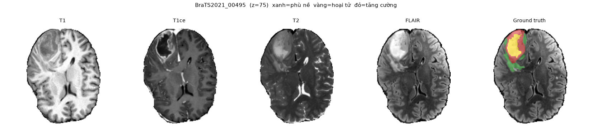

**Hình 1.1.** Cùng một lát axial của ca `BraTS2021_00495` trên T1, T1ce, T2,
FLAIR và ground truth. Màu xanh biểu diễn vùng phù, vàng biểu diễn vùng
hoại tử/không tăng cường và đỏ biểu diễn vùng tăng cường. Nguồn: dữ liệu và
script trực quan hóa của nhóm.

### 1.1.2. Thách thức về hình thái và ranh giới u

Khối u não không phải một đối tượng có hình dạng cố định. Những khó khăn chính
gồm:

1. **Biến thiên hình thái:** u có thể nhỏ, lớn, đơn ổ, đa ổ hoặc lan tỏa.
2. **Ranh giới mờ:** vùng phù và mô lành có cường độ gần nhau trên một số chuỗi.
3. **Không đồng nhất nội tại:** hoại tử, vùng không tăng cường và vùng tăng
   cường có đặc điểm tín hiệu khác nhau.
4. **Mất cân bằng lớp:** phần lớn voxel thuộc nền hoặc mô não lành; ET thường
   chỉ chiếm một tỷ lệ rất nhỏ.
5. **Quan hệ lồng nhau:** ET phải nằm trong TC và TC phải nằm trong WT; dự đoán
   độc lập có thể vi phạm quan hệ này.
6. **Chi phí 3D:** một thể tích gồm hàng triệu voxel, gây áp lực lên VRAM và
   thời gian huấn luyện.

### 1.1.3. Yêu cầu đối với hệ thống hỗ trợ chẩn đoán tự động

Một hệ thống phân đoạn có khả năng sử dụng trong nghiên cứu hoặc hỗ trợ lâm
sàng cần đáp ứng các yêu cầu sau:

- dự đoán chính xác cả vùng lớn WT và các vùng nhỏ TC, ET;
- duy trì biên hình học hợp lý, không chỉ đạt độ chồng lấp cao;
- xử lý được toàn bộ thể tích MRI và bảo toàn affine khi xuất NIfTI;
- cho kết quả có thể quan sát, kiểm tra và tải về;
- ghi nhận rõ preprocessing, checkpoint, ngưỡng và phiên bản mô hình;
- không trình bày dự đoán như kết luận y khoa độc lập.

Dice được dùng để đo mức chồng lấp, còn HD95 đánh giá sai lệch biên. Hai chỉ số
bổ sung cho nhau: mask có Dice tương đối cao vẫn có thể chứa một cụm dự đoán xa
vùng thật và làm HD95 tăng mạnh.

## 1.2. Mục tiêu nghiên cứu và đóng góp

### 1.2.1. Mục tiêu tổng quát

Mục tiêu của đề tài là nghiên cứu và xây dựng một hệ thống phân đoạn tự động ba
vùng u WT, TC và ET trên ảnh MRI đa chuỗi xung BraTS 2021; so sánh baseline CNN
với mô hình có Transformer decoder; và đề xuất một kiến trúc CNN–Mamba 3D cho
giai đoạn nghiên cứu tiếp theo.

Mục tiêu “hỗ trợ chuyên gia” được hiểu là cung cấp mặt nạ tham khảo và công cụ
trực quan. Với quy mô thực nghiệm hiện tại, báo cáo **không tuyên bố** mô hình
đạt năng lực tương đương bác sĩ hoặc đủ điều kiện sử dụng lâm sàng.

### 1.2.2. Mục tiêu cụ thể

- Chuẩn hóa quy trình đọc, crop và chuẩn hóa dữ liệu NIfTI.
- Chuyển nhãn BraTS `{0,1,2,4}` thành ba vùng WT/TC/ET.
- Xây dựng tập train/validation/test không trùng bệnh nhân.
- Huấn luyện U-Net 2D và TransUNet 2D trong cùng điều kiện.
- Đánh giá trên 30 ca test bằng Dice và HD95.
- Tích hợp checkpoint vào giao diện Streamlit.
- Đề xuất DAU-Mamba với khối DSH và UGSF.
- Xây dựng kế hoạch ablation để kiểm chứng từng đóng góp.

### 1.2.3. Các đóng góp chính

1. **Pipeline dữ liệu có thể tái lập:** hỗ trợ `.tar`, thư mục NIfTI và `.npz`,
   không bắt buộc giải nén toàn bộ dữ liệu trước khi huấn luyện.
2. **So sánh thực nghiệm công bằng:** U-Net và TransUNet dùng cùng split, seed,
   kích thước patch, batch và lịch learning rate.
3. **Phân tích đúng bản chất mô hình:** làm rõ TransUNet của dự án là U-Net kết
   hợp Transformer decoder theo query, khác với UNETR hoặc TransUNet 2021 dùng
   Transformer ở encoder/bottleneck.
4. **Ứng dụng demo:** hiển thị modality, ground truth, dự đoán, overlay và Dice.
5. **Kiến trúc đề xuất DAU-Mamba:** kết hợp học cục bộ, phụ thuộc xa, thích nghi
   hướng và hướng dẫn bất định trong một mạng 3D.

## 1.3. Đối tượng nghiên cứu và dữ liệu

### 1.3.1. Bộ dữ liệu BraTS 2021

BraTS 2021 là benchmark đa trung tâm cho phân đoạn u thần kinh đệm trên MRI [5].
Dữ liệu đã được đồng đăng ký về cùng không gian, nội suy về cùng độ phân giải và
loại bỏ hộp sọ. Đề tài sử dụng một tập con 200 ca có nhãn, thay vì toàn bộ tập
BraTS, để phù hợp với giới hạn thời gian và phần cứng.

Mỗi ca gồm năm file:

```text
BraTS2021_xxxxx/
├── BraTS2021_xxxxx_t1.nii.gz
├── BraTS2021_xxxxx_t1ce.nii.gz
├── BraTS2021_xxxxx_t2.nii.gz
├── BraTS2021_xxxxx_flair.nii.gz
└── BraTS2021_xxxxx_seg.nii.gz
```

**Bảng 1.2. Phân hoạch 200 ca BraTS 2021**

| Tập | Số ca | Tỷ lệ | Mục đích |
|---|---:|---:|---|
| Train | 140 | 70% | Cập nhật tham số mô hình |
| Validation | 30 | 15% | Chọn checkpoint và điều chỉnh mô hình |
| Test | 30 | 15% | Báo cáo kết quả cuối cùng |
| Tổng | 200 | 100% | Không trùng ca giữa các tập |

Trong quá trình train, chương trình chỉ đánh giá 10 ca validation mỗi lần để
tiết kiệm thời gian. Vì vậy, “best validation” trong log là kết quả trên 10 ca,
không phải toàn bộ 30 ca validation.

### 1.3.2. Biểu diễn nhãn

Nhãn BraTS gốc sử dụng các giá trị `{0,1,2,4}`. Pipeline chuyển sang ba kênh nhị
phân theo giao thức đánh giá của BraTS.

**Bảng 1.3. Biểu diễn ba vùng u lồng nhau**

| Vùng | Công thức từ nhãn gốc | Ý nghĩa |
|---|---|---|
| WT | `seg > 0` | Toàn bộ tổn thương: nhãn 1, 2 và 4 |
| TC | `seg == 1 hoặc seg == 4` | Lõi u: vùng hoại tử/không tăng cường và tăng cường |
| ET | `seg == 4` | Vùng u tăng cường |

Quan hệ hình học mong muốn là:

$$
ET\subseteq TC\subseteq WT.
$$

### 1.3.3. Phạm vi nghiên cứu

Phần đã hoàn thành tập trung vào huấn luyện 2D theo lát axial và suy luận toàn
volume bằng cách ghép kết quả các lát. Các cấu hình 3D và kiến trúc DAU-Mamba đã
được thiết kế nhưng chưa huấn luyện đầy đủ. Đề tài không thực hiện chẩn đoán loại
u, tiên lượng sống còn hoặc phát hiện MGMT; đầu ra chỉ là mặt nạ phân đoạn.

---

# Chương 2. THIẾT KẾ KIẾN TRÚC QUY TRÌNH XỬ LÝ

## 2.1. Tổng quan luồng xử lý end-to-end

Hệ thống được tổ chức thành sáu giai đoạn liên tiếp:

```text
(1) Đọc và tiền xử lý NIfTI
              ↓
(2) Lấy mẫu lát cắt/patch có ưu tiên vùng u
              ↓
(3) Phân đoạn bằng U-Net hoặc TransUNet
              ↓
(4) Suy luận toàn volume 2D hoặc cửa sổ trượt 3D
              ↓
(5) Ghép xác suất và khôi phục kích thước gốc
              ↓
(6) Ràng buộc vùng lồng nhau, threshold và trực quan hóa
```

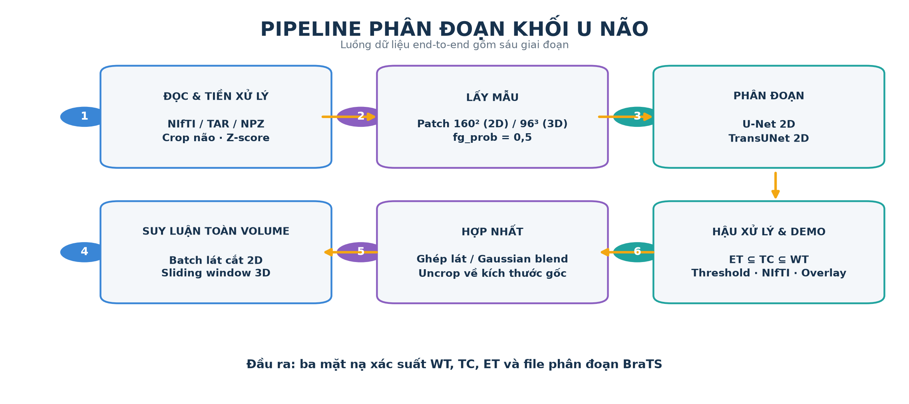

**Hình 2.1.** Luồng xử lý end-to-end sáu giai đoạn. Hình được nhóm dựng bằng
code từ pipeline thực tế của hai kho mã nguồn.

**Bảng 2.1. Sáu giai đoạn của pipeline**

| Giai đoạn | Đầu vào | Xử lý chính | Đầu ra |
|---|---|---|---|
| 1. Tiền xử lý | 4 MRI + nhãn NIfTI | Crop não, z-score, chuyển nhãn | Volume chuẩn hóa và 3 region |
| 2. Lấy mẫu | Volume đã crop | Chọn lát/patch, ưu tiên foreground, augmentation | Batch huấn luyện |
| 3. Phân đoạn | Batch tensor | U-Net hoặc TransUNet | Logit/xác suất WT, TC, ET |
| 4. Suy luận | Toàn volume | Batch lát 2D hoặc sliding window 3D | Xác suất toàn volume |
| 5. Hợp nhất | Các dự đoán cục bộ | Gaussian blend ở 3D, uncrop | Xác suất đúng kích thước gốc |
| 6. Hậu xử lý | Xác suất 3 kênh | Cumulative max, threshold, chuyển NIfTI | Mask cuối và hình minh họa |

Hai nhánh suy luận cần được phân biệt:

- **Mô hình 2D đã thực nghiệm:** xử lý các lát có não theo batch, sau đó đặt kết
  quả trở lại đúng vị trí z.
- **Mô hình 3D/DAU-Mamba dự kiến:** dùng cửa sổ trượt `96³`, overlap 0,5 và
  Gaussian blending. Quy trình 3D đã được hỗ trợ ở mức code nhưng chưa tạo ra
  kết quả benchmark chính trong báo cáo.

## 2.2. Giai đoạn 1 và 2: Tiền xử lý và lấy mẫu

### 2.2.1. Đọc dữ liệu

Lớp dữ liệu hỗ trợ ba nguồn:

- đọc trực tiếp từng ca từ file `.tar`;
- đọc từ thư mục NIfTI đã giải nén;
- đọc cache `.npz` đã crop để giảm thời gian I/O.

Việc đọc trực tiếp từ `.tar` giúp tiết kiệm dung lượng, còn cache `.npz` phù hợp
khi GPU thường xuyên phải chờ dữ liệu. Mỗi DataLoader worker duy trì một pool
nhỏ các volume trong RAM, cắt nhiều mẫu trước khi nạp ca mới.

### 2.2.2. Crop vùng não

Nền ngoài não trong BraTS có giá trị 0. Pipeline tìm bounding box nhỏ nhất bao
quanh tất cả voxel khác 0 trên bốn modality. Ảnh và nhãn được crop chung theo
bounding box này. Tọa độ crop, kích thước gốc và affine được lưu để khôi phục dự
đoán về không gian ban đầu.

### 2.2.3. Chuẩn hóa cường độ

MRI không có thang cường độ tuyệt đối thống nhất giữa bệnh nhân. Với từng
modality, z-score chỉ được tính trên vùng khác nền:

$$
x' = \frac{x-\mu_{brain}}{\sigma_{brain}+\epsilon}.
$$

Voxel nền được giữ ở 0. Cách này tránh để vùng nền lớn ảnh hưởng trung bình và
độ lệch chuẩn.

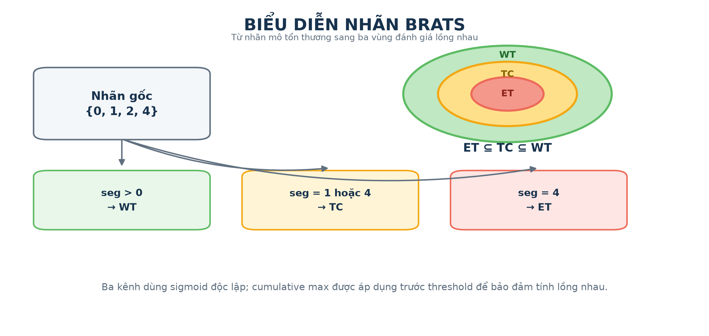

**Hình 2.2.** Chuyển nhãn BraTS `{0,1,2,4}` thành ba vùng đánh giá lồng nhau.
Hình được nhóm dựng từ hàm `seg_to_regions` trong mã nguồn.

### 2.2.4. Lấy mẫu có ưu tiên foreground

Để giảm mất cân bằng, cấu hình đặt `fg_prob = 0.5`:

- với xác suất 0,5, lát hoặc patch được chọn quanh voxel thuộc WT;
- trong các trường hợp còn lại, mẫu được chọn từ vùng có não;
- patch 2D được crop về `160 × 160`;
- cấu hình 3D dự kiến dùng patch `96 × 96 × 96`.

Chiến lược này không thay đổi phân bố test, chỉ làm batch huấn luyện chứa nhiều
tín hiệu foreground hơn.

### 2.2.5. Tăng cường dữ liệu

Pipeline huấn luyện có thể áp dụng:

- lật ngẫu nhiên theo các trục không gian;
- affine 2D với xác suất 0,2, góc quay tối đa khoảng 15° và scale 0,1;
- thay đổi cường độ và dịch cường độ;
- nhiễu Gaussian.

Ảnh sử dụng nội suy bilinear trong affine, còn nhãn sử dụng nearest-neighbor để
không sinh giá trị nhãn trung gian.

## 2.3. Giai đoạn 3: Phân đoạn khối u

### 2.3.1. Kiến trúc U-Net 2D

U-Net [1] gồm encoder, bottleneck, decoder và skip connection. Encoder giảm dần độ
phân giải để mở rộng receptive field; decoder tăng độ phân giải; skip connection
chuyển chi tiết không gian từ encoder sang decoder.

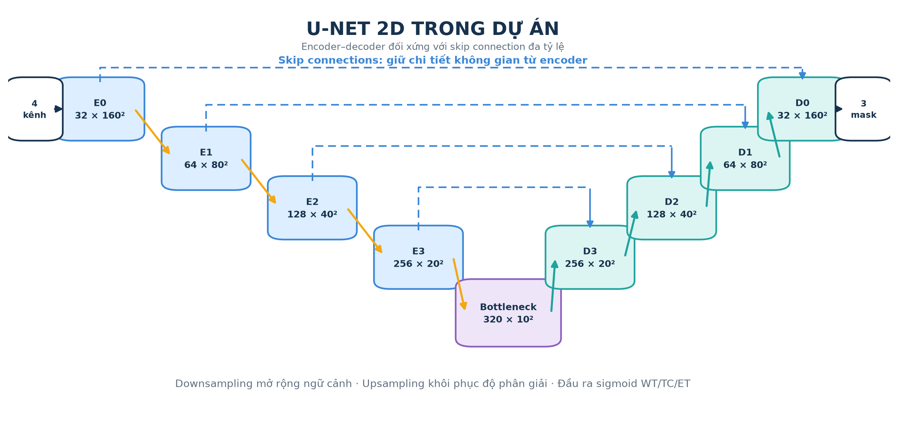

**Hình 2.3.** U-Net 2D của dự án với năm mức kênh, bốn skip connection và đầu
ra ba mask sigmoid. Hình được sinh bằng code dựa trên cấu hình `unet2d.yaml`.

Mô hình trong dự án sử dụng năm mức kênh:

```text
4 → 32 → 64 → 128 → 256 → 320
              bottleneck
320 → 256 → 128 → 64 → 32 → 3 region logits
```

Đầu vào là tensor `B × 4 × 160 × 160`, đầu ra là
`B × 3 × 160 × 160`. Ba kênh dùng sigmoid độc lập do WT, TC và ET có quan hệ
lồng nhau thay vì loại trừ nhau.

Hàm mất mát U-Net:

$$
\mathcal{L}_{UNet}=\mathcal{L}_{BCE}+1-DSC_{soft}.
$$

U-Net 2D có khoảng **5,686 triệu tham số**.

### 2.3.2. Kiến trúc TransUNet 2D decoder-only

Mô hình được triển khai dựa trên tư tưởng decoder-only của 3D TransUNet [3], không
phải UNETR. Một backbone U-Net tạo đặc trưng đa tỷ lệ. Transformer decoder sử
dụng 20 query học được để tạo các cặp `(lớp, mask)`.

Ba tầng decoder hoạt động coarse-to-fine:

1. query cross-attend lên feature tỷ lệ `1/8`;
2. mask trung gian tạo attention mask cho tầng tiếp theo;
3. query tiếp tục cross-attend lên tỷ lệ `1/4` rồi `1/2`;
4. mỗi query dự đoán một trong bốn lớp `WT`, `TC`, `ET`, `no-object` và một mask.

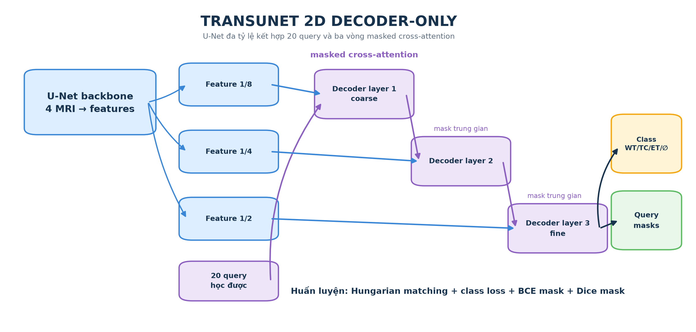

**Hình 2.4.** Luồng coarse-to-fine của Transformer decoder: 20 query lần lượt
nhận đặc trưng U-Net ở ba tỷ lệ và xuất class cùng query mask. Hình được sinh từ
cấu hình và mã `transformer_decoder.py` của dự án.

Cấu hình chính:

| Thuộc tính | Giá trị |
|---|---:|
| Số query | 20 |
| Hidden dimension | 192 |
| Số tầng decoder | 3 |
| Số attention head | 8 |
| FFN multiplier | 8 |
| Multi-scale indices | `[-4, -3, -2]` |
| Masked attention | Có |

TransUNet 2D có khoảng **8,568 triệu tham số**.

### 2.3.3. Hungarian matching và SetCriterion

Ground truth của một ảnh là danh sách các region không rỗng, tối đa ba đối
tượng. Hungarian matching ghép một-một các query với ground truth theo chi phí:

$$
\mathcal{C}=2\mathcal{C}_{class}
+5\mathcal{C}_{BCE-mask}
+5\mathcal{C}_{Dice-mask}.
$$

Query không được ghép học lớp `no-object`, với trọng số 0,1. Loss được tính cho
đầu ra cuối và các đầu ra trung gian. Do U-Net và TransUNet dùng hai hàm mất mát
khác nhau, giá trị `train_loss` giữa hai mô hình không có cùng thang đo và không
được dùng để kết luận mô hình nào tốt hơn.

### 2.3.4. So sánh hai mô hình

**Bảng 2.2. So sánh U-Net 2D và TransUNet 2D**

| Tiêu chí | U-Net 2D | TransUNet 2D |
|---|---|---|
| Backbone | CNN encoder–decoder | U-Net CNN |
| Đầu dự đoán | Conv `1×1`, 3 kênh | 20 query + Transformer decoder |
| Quan hệ xa | Gián tiếp qua downsampling | Cross-attention đa tỷ lệ |
| Loss | BCE + Dice | Class + BCE mask + Dice mask |
| Ghép dự đoán | Không cần | Hungarian matching |
| Tham số | 5,686M | 8,568M |
| Ưu điểm | Đơn giản, ổn định | Biểu diễn linh hoạt theo query |
| Rủi ro | Hạn chế phụ thuộc xa | Khó tối ưu hơn, nhạy với no-object/query |

## 2.4. Giai đoạn 4 và 5: Suy luận và hợp nhất

### 2.4.1. Suy luận 2D đang sử dụng

Với mô hình 2D, pipeline:

1. tìm các lát axial có não;
2. gom tối đa 16 lát vào một batch;
3. pad hai chiều để chia hết cho hệ số downsampling;
4. dự đoán ba bản đồ xác suất;
5. cắt phần pad và đặt kết quả trở lại tọa độ z;
6. khôi phục volume từ bounding box về kích thước gốc.

Cách làm này xử lý toàn volume nhưng mỗi dự đoán không trực tiếp thấy lát trước
và sau. Đây là hạn chế chính của thực nghiệm 2D.

### 2.4.2. Sliding window 3D

Với mô hình 3D, một volume được chia thành các cửa sổ `96 × 96 × 96`, chồng lấn
50%. Mỗi cửa sổ được dự đoán độc lập. Sliding window cho phép suy luận thể tích
lớn hơn VRAM nhưng làm tăng số lần forward.

### 2.4.3. Gaussian blending

Ở vùng chồng lấn, các voxel gần tâm patch đáng tin cậy hơn voxel gần biên.
Gaussian blending gán trọng số lớn ở tâm và nhỏ ở biên, sau đó tính trung bình
có trọng số:

$$
P(v)=\frac{\sum_k w_k(v)P_k(v)}{\sum_k w_k(v)+\epsilon}.
$$

Trong đó $P_k(v)$ là xác suất của cửa sổ thứ $k$, còn $w_k(v)$ là trọng
số Gaussian. Cơ chế này thuộc nhánh suy luận 3D, không được sử dụng để tạo bảng
kết quả 2D hiện tại.

## 2.5. Giai đoạn 6: Hậu xử lý và định danh vùng u

### 2.5.1. Cumulative max

Trước khi threshold, pipeline áp đặt quan hệ xác suất:

$$
p_{TC}\leftarrow\max(p_{TC},p_{ET}),
$$

$$
p_{WT}\leftarrow\max(p_{WT},p_{TC}).
$$

Khi đó $p_{WT}\ge p_{TC}\ge p_{ET}$ tại mọi voxel. Cách này giữ lại ET khi
mô hình chắc chắn về ET nhưng còn lưỡng lự về TC.

### 2.5.2. Threshold và chuyển về nhãn BraTS

Ba kênh được nhị phân hóa với ngưỡng mặc định 0,5. Khi chuyển về nhãn BraTS:

- voxel WT nhận nhãn 2;
- voxel TC ghi đè thành nhãn 1;
- voxel ET ghi đè thành nhãn 4.

Kết quả được uncrop, gắn lại affine và có thể lưu dưới dạng `.nii.gz`.

## 2.6. Giao diện trình diễn

Ứng dụng Streamlit trong `Brain-Tumor-segmentation/app.py` cung cấp:

- lựa chọn U-Net hoặc TransUNet;
- tải bốn file T1, T1ce, T2, FLAIR;
- tùy chọn tải ground truth;
- duyệt lát cắt axial;
- hiển thị ảnh gốc, mask, overlay và thể tích vùng;
- tính Dice khi có nhãn;
- xuất mask dự đoán NIfTI.

Giao diện dùng cùng preprocessing, model definition và hậu xử lý với pipeline
đánh giá, nhờ đó tránh sai khác giữa demo và thực nghiệm.

---

# Chương 3. CƠ SỞ LÝ THUYẾT VÀ KIẾN TRÚC ĐỀ XUẤT DAU-MAMBA

## 3.1. Cơ sở lý thuyết của mô hình hóa chuỗi dài

### 3.1.1. Hạn chế của CNN và self-attention

Tích chập có receptive field cục bộ. Receptive field có thể mở rộng qua nhiều
tầng, nhưng quan hệ giữa hai vùng xa vẫn phải truyền qua chuỗi phép biến đổi.
Self-attention cho phép mọi token tương tác trực tiếp nhưng cần ma trận chú ý
`N × N`; độ phức tạp thời gian và bộ nhớ xấp xỉ $O(N^2)$. Với thể tích 3D,
số token tăng rất nhanh và attention đầy đủ khó triển khai trên GPU ít VRAM.
UNETR [2] là một ví dụ sử dụng Transformer encoder để học ngữ cảnh toàn cục cho
phân đoạn ảnh y khoa 3D.

### 3.1.2. State Space Model

Một hệ trạng thái liên tục tuyến tính:

$$
h'(t)=Ah(t)+Bx(t),
$$

$$
y(t)=Ch(t)+Dx(t),
$$

trong đó $x$ là đầu vào, $h$ là trạng thái ẩn và $y$ là đầu ra. Sau khi
rời rạc hóa với bước $\Delta$:

$$
h_t=\bar{A}h_{t-1}+\bar{B}x_t,
\qquad
y_t=Ch_t+Dx_t.
$$

SSM nén lịch sử chuỗi vào trạng thái ẩn và có thể xử lý tuần tự với chi phí
tuyến tính theo chiều dài chuỗi.

### 3.1.3. Selective State Space Model và Mamba

Mamba [4] làm một số tham số SSM phụ thuộc đầu vào. Cơ chế chọn lọc cho phép mô hình
quyết định nội dung cần ghi nhớ, truyền tiếp hoặc loại bỏ tại từng vị trí. Thuật
toán selective scan được thiết kế để thực thi hiệu quả trên phần cứng và tránh
ma trận attention bậc hai.

Nếu feature map 3D được trải thành chuỗi $N=HWD$ token:

| Cơ chế | Độ phức tạp theo số token | Nhận xét |
|---|---:|---|
| Self-attention | $O(N^2)$ | Khó mở rộng khi `H×W×D` lớn |
| Selective scan | $O(N)$ | Phù hợp chuỗi voxel dài hơn |

### 3.1.4. Vấn đề hướng quét trong dữ liệu 3D

Thể tích không có thứ tự một chiều tự nhiên. Nếu chỉ flatten theo một hướng,
mô hình có thể thiên lệch theo thứ tự đó. DAU-Mamba sử dụng ba hướng:

- **Forward:** thứ tự voxel thuận;
- **Reverse:** thứ tự đảo ngược;
- **Inter-slice:** ưu tiên quan hệ giữa các lát cắt.

Các hướng có tham số riêng và được hợp nhất theo trọng số phụ thuộc từng mẫu.

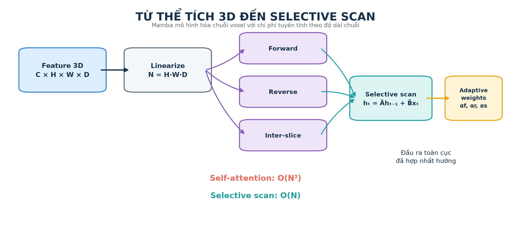

**Hình 3.1.** Feature 3D được tuyến tính hóa và quét theo ba hướng trước khi
hợp nhất thích nghi. Hình được nhóm dựng từ cơ sở SSM/Mamba [4] và đặc tả
DAU-Mamba.

## 3.2. Kiến trúc đề xuất DAU-Mamba

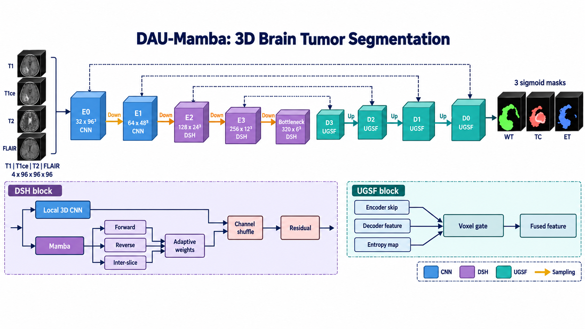

**Hình 3.2. Kiến trúc tổng thể DAU-Mamba.** Hình được dựng mới từ đặc tả nội bộ
`DAU_Mamba_Kien_truc.md`. Đây là hình mô tả thiết kế, không phải kiến trúc đã
được huấn luyện trong bảng kết quả Chương 4.

### 3.2.1. Triết lý thiết kế

DAU-Mamba áp dụng ba nguyên tắc:

1. **CNN ở tầng nông:** giữ thiên kiến cục bộ và chi tiết biên.
2. **CNN–Mamba ở tầng sâu:** học đồng thời texture cục bộ và phụ thuộc xa khi
   feature map đã nhỏ hơn.
3. **Bất định điều khiển decoder:** tập trung skip connection vào vùng biên hoặc
   vùng mô hình chưa chắc chắn.

### 3.2.2. Kích thước tensor

**Bảng 3.2. Kích thước tensor dự kiến trong DAU-Mamba**

| Mức | Kích thước không gian | Số kênh | Khối chính |
|---|---:|---:|---|
| Input | `96³` | 4 | T1, T1ce, T2, FLAIR |
| E0 | `96³` | 32 | Residual 3D CNN |
| E1 | `48³` | 64 | Residual 3D CNN |
| E2 | `24³` | 128 | DSH |
| E3 | `12³` | 256 | DSH |
| Bottleneck | `6³` | 320 | DSH |
| D3 → D0 | `12³ → 96³` | giảm dần | UGSF + residual CNN |
| Output | `96³` | 3 | Sigmoid WT, TC, ET |

Đặt Mamba từ E2 trở xuống giúp giảm chiều dài chuỗi so với áp dụng trực tiếp ở
độ phân giải `96³`.

## 3.3. Khối lai chia nhánh thích nghi hướng

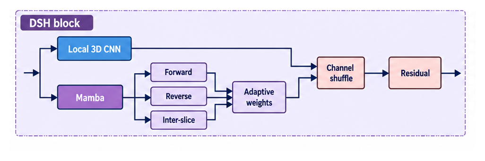

**Hình 3.3.** Khối DSH chia đặc trưng thành nhánh Local 3D CNN và nhánh Mamba
đa hướng, sau đó hợp nhất, channel shuffle và cộng residual. Hình được cắt từ
sơ đồ tổng thể do nhóm xây dựng.

### 3.3.1. Chia nhánh cục bộ và toàn cục

Cho tensor $F$, mô hình chiếu và chia kênh theo tỷ lệ 1:1:

$$
F_l,F_g=Split(Proj(F)).
$$

Nhánh cục bộ:

$$
L=Conv_{3D}(F_l),
$$

nhằm học texture, cạnh và cấu trúc lân cận. Nhánh toàn cục đưa $F_g$ qua các
selective scan.

### 3.3.2. Ba hướng Mamba

$$
M_f=Mamba_f(F_g),
\quad
M_r=Mamba_r(F_g),
\quad
M_s=Mamba_s(F_g).
$$

`Forward` và `Reverse` giảm thiên lệch theo thứ tự, còn `Inter-slice` nhấn mạnh
tính liên tục theo trục lát cắt.

### 3.3.3. Trọng số hướng thích nghi

Một vector mô tả toàn cục được tạo bằng global average pooling. MLP và softmax
sinh ba trọng số:

$$
[\alpha_f,\alpha_r,\alpha_s]
=Softmax(MLP(GAP(F_g))),
$$

với $\alpha_f+\alpha_r+\alpha_s=1$. Đặc trưng toàn cục:

$$
G=\alpha_fM_f+\alpha_rM_r+\alpha_sM_s.
$$

Trọng số được học theo từng bệnh nhân thay vì cố định. Một khối u lan mạnh theo
trục z có thể ưu tiên inter-slice, trong khi u tập trung trên ít lát có thể ưu
tiên hướng nội lát.

### 3.3.4. Hợp nhất và residual

$$
F_{out}=F+Proj(ChannelShuffle([L;G])).
$$

Channel shuffle tạo trao đổi thông tin giữa hai nhóm kênh; residual giúp ổn định
gradient và cho phép khối học phần hiệu chỉnh thay vì biến đổi toàn bộ feature.

## 3.4. Hợp nhất skip connection dựa trên độ bất định

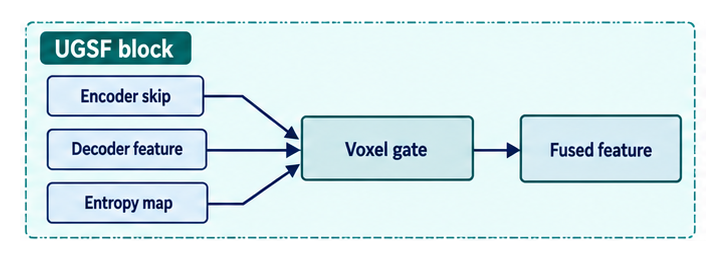

**Hình 3.4.** UGSF sử dụng encoder skip, decoder feature và entropy map để sinh
voxel gate, từ đó tạo đặc trưng hợp nhất. Hình được cắt từ sơ đồ tổng thể do
nhóm xây dựng.

### 3.4.1. Tín hiệu entropy

Tại mỗi mức decoder, một đầu dự đoán phụ tạo xác suất $p$. Entropy nhị phân:

$$
U=-p\log(p+\epsilon)-(1-p)\log(1-p+\epsilon).
$$

Entropy thấp khi xác suất gần 0 hoặc 1, cao khi xác suất gần 0,5. Vì thế, $U$
đóng vai trò bản đồ vùng chưa chắc chắn.

### 3.4.2. Voxel gate

Cho feature encoder $E$, feature decoder $V$ và entropy $U$:

$$
G=\sigma(Conv([E;V;U])).
$$

Kết quả hợp nhất:

$$
F_{fuse}=G\odot E+(1-G)\odot V.
$$

Gate có giá trị theo voxel và kênh. Ở vùng cần chi tiết biên, mô hình có thể ưu
tiên encoder; ở vùng cần ngữ cảnh, mô hình có thể ưu tiên decoder.

### 3.4.3. Deep supervision

Các auxiliary head được nội suy về kích thước ground truth và đưa vào loss:

$$
\mathcal{L}_{total}
=\mathcal{L}_{final}
+\sum_{i=1}^{4}\lambda_i\mathcal{L}_{aux}^{(i)}.
$$

Deep supervision cung cấp gradient trực tiếp cho các mức decoder, đồng thời tạo
entropy phục vụ UGSF. Trọng số $\lambda_i$ cần được chọn trên validation.

## 3.5. Nguồn ý tưởng và điểm mới dự kiến

**Bảng 3.1. Nguồn ý tưởng của DAU-Mamba**

| Công trình | Ý tưởng tham khảo | Điều chỉnh trong DAU-Mamba |
|---|---|---|
| U-Net | Encoder–decoder và skip connection | Chuyển sang residual 3D và UGSF |
| U-Mamba [6] | CNN–SSM trong mạng U-shaped | Dùng split branch và đa hướng |
| MedMamba [7] | SS-Conv-SSM, channel shuffle | Áp dụng cho segmentation 3D |
| SegMamba [8] | Mamba đa hướng cho thể tích | Học trọng số hướng theo từng ca |
| SegResMamba [9] | Thiết kế Mamba 3D hiệu quả | Giữ decoder gọn |

Hai đóng góp cần kiểm chứng của DAU-Mamba là:

- **Direction-adaptive fusion:** không cộng đều ba hướng mà học trọng số phụ
  thuộc mẫu.
- **Uncertainty-guided skip fusion:** dùng entropy đầu phụ để điều khiển lượng
  thông tin từ encoder và decoder.

Các mô tả “giúp”, “cải thiện” trong chương này là kỳ vọng thiết kế, không phải
kết luận thực nghiệm.

## 3.6. So sánh DAU-Mamba và CGR-Mamba

**Bảng 3.3. So sánh hai kiến trúc đề xuất**

| Tiêu chí | DAU-Mamba | CGR-Mamba |
|---|---|---|
| Vị trí Mamba | E2, E3 và bottleneck | Một refinement block ở F2 |
| Kiến trúc chính | Encoder–decoder tích hợp | CNN backbone + nhánh refinement |
| Tín hiệu hướng dẫn | Entropy decoder | Coarse prediction |
| Hợp nhất cuối | UGSF nhiều mức | `Z_final = Z_c + G ⊙ ΔZ` |
| Lợi thế kỳ vọng | Ngữ cảnh đa tỷ lệ | Gọn, sửa coarse có kiểm soát |
| Chi phí/rủi ro | Nhiều khối Mamba hơn | Refinement một tỷ lệ có thể thiếu chi tiết |

DAU-Mamba được chọn làm phương án chính cho báo cáo vì thể hiện rõ đóng góp ở
cả encoder và decoder. CGR-Mamba phù hợp làm đối chứng về hiệu quả tài nguyên.

## 3.7. Quy trình huấn luyện và suy luận dự kiến cho DAU-Mamba

Đầu vào là patch `4 × 96³`, batch 1 và có thể cộng dồn gradient để đạt batch
hiệu dụng 2. Optimizer dự kiến là AdamW, AMP được bật khi dùng CUDA. Loss ban đầu
nên dùng BCE + Dice với deep supervision; sau đó mới khảo sát Tversky hoặc focal
loss để tránh thay đổi quá nhiều yếu tố cùng lúc.

Suy luận sử dụng sliding window overlap 0,5, Gaussian blending, cumulative max
và threshold 0,5. Các ngưỡng, connected-component filtering hoặc quy tắc loại
ET nhỏ phải được chọn trên validation, tuyệt đối không điều chỉnh theo test.

---

# Chương 4. THỰC NGHIỆM, KẾT QUẢ VÀ SO SÁNH

## 4.1. Thiết lập thực nghiệm và giao thức đánh giá

### 4.1.1. Cấu hình phần cứng và phần mềm

Tài liệu setup của dự án ghi nhận máy huấn luyện dùng GPU NVIDIA RTX 3050 Ti có
4 GB VRAM. Không có bằng chứng trong log cho GPU NVIDIA T4; vì vậy báo cáo dùng
đúng cấu hình đã ghi nhận. Nếu nhóm thực tế chạy lại trên T4, cần thay bảng này
bằng kết quả `nvidia-smi` của lần chạy đó.

**Bảng 4.1. Cấu hình môi trường**

| Thành phần | Cấu hình |
|---|---|
| Hệ điều hành | Windows, Python native |
| GPU | NVIDIA RTX 3050 Ti, 4 GB VRAM |
| Framework | PyTorch, MONAI |
| Thư viện dữ liệu | NumPy, NiBabel, SciPy |
| Trực quan hóa | Matplotlib, Streamlit |
| Mixed precision | CUDA AMP FP16/FP32 |
| Seed | 42 |
| CPU/RAM | `[Bổ sung từ máy huấn luyện nếu cần]` |

### 4.1.2. Siêu tham số

**Bảng 4.2. Siêu tham số hai run chính**

| Thuộc tính | Giá trị |
|---|---|
| Dữ liệu | BraTS 2021, split 200 ca |
| Train/Val/Test | 140/30/30 ca |
| Spatial dimensions | 2D |
| Patch | `160 × 160` |
| Batch size | 8 |
| Epoch | 20 |
| Iteration/epoch | 250 |
| Optimizer | AdamW |
| Learning rate cực đại | `3 × 10⁻⁴` |
| Weight decay | `3 × 10⁻⁵` |
| Warm-up | 2 epoch |
| Scheduler | Cosine decay về `10⁻⁶` |
| Foreground probability | 0,5 |
| Validation | Mỗi 5 epoch, 10 ca |
| Ngưỡng suy luận | 0,5 |

### 4.1.3. Dice Similarity Coefficient

Với mask dự đoán $P$ và ground truth $G$:

$$
DSC(P,G)=\frac{2|P\cap G|+\epsilon}{|P|+|G|+\epsilon}.
$$

Dice nằm trong `[0,1]`, càng cao càng tốt. Báo cáo tính Dice riêng cho WT, TC,
ET và trung bình ba vùng.

### 4.1.4. Hausdorff Distance 95%

$$
HD95(P,G)=\max\{Q_{0.95}(d(\partial P,\partial G)),
Q_{0.95}(d(\partial G,\partial P))\}.
$$

HD95 càng thấp càng tốt. Phân vị 95% giảm độ nhạy với một số ít điểm ngoại lai
so với Hausdorff cực đại.

### 4.1.5. Giao thức lựa chọn mô hình

Checkpoint `best.pt` được chọn bằng Dice mean trên tập validation dùng trong
quá trình train. Test chỉ được dùng để báo cáo cuối. Ca `BraTS2021_00495` không
nằm trong split 200 của hai run chính; kết quả của ca này chỉ minh họa demo.

## 4.2. Tiến trình huấn luyện

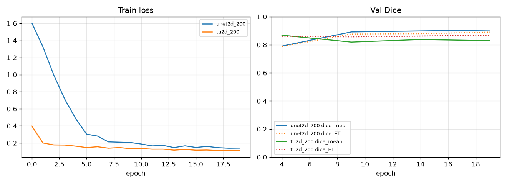

**Hình 4.1.** Đường cong loss và Dice validation từ `log.csv`. Loss của hai mô
hình khác định nghĩa nên chỉ so sánh xu hướng trong cùng một mô hình.

U-Net giảm loss ổn định và Dice validation tăng qua các mốc 5 epoch. TransUNet
đạt validation mean cao nhất ở epoch 4; sau đó TC giảm dù training loss tiếp tục
giảm. Đây là dấu hiệu mô hình có thể overfit hoặc cơ chế query/class score chưa
ổn định trên một số ca.

**Bảng 4.3. Kết quả validation tốt nhất trong khi train**

| Mô hình | Epoch tốt nhất | WT | TC | ET | Mean |
|---|---:|---:|---:|---:|---:|
| **U-Net 2D** | 19 | 0,9353 | 0,8899 | 0,8904 | **0,9052** |
| TransUNet 2D | 4 | 0,8881 | 0,8556 | 0,8608 | 0,8682 |

Các số validation trên chỉ dựa trên 10 ca được cấu hình để đánh giá nhanh.

## 4.3. Kết quả benchmark trên 30 ca test

### 4.3.1. Dice

**Bảng 4.4. Dice trung bình trên 30 ca test**

| Mô hình | WT ↑ | TC ↑ | ET ↑ | Mean ↑ |
|---|---:|---:|---:|---:|
| **U-Net 2D** | **0,8701** | **0,8566** | **0,8296** | **0,8521** |
| TransUNet 2D | 0,8288 | 0,7820 | 0,7885 | 0,7997 |
| Chênh lệch U-Net − TransUNet | +0,0413 | +0,0747 | +0,0411 | +0,0524 |

U-Net cao hơn TransUNet 5,24 điểm phần trăm Dice mean trong thiết lập hiện tại.
Chênh lệch lớn nhất ở TC, cho thấy TransUNet gặp khó với vùng lõi u.

### 4.3.2. HD95

**Bảng 4.5. HD95 trung bình trên 30 ca test**

| Mô hình | WT ↓ | TC ↓ | ET ↓ |
|---|---:|---:|---:|
| **U-Net 2D** | **16,88** | **12,78** | **9,66** |
| TransUNet 2D | 46,32 | 35,07 | 29,62 |

TransUNet có HD95 cao hơn rõ rệt, cho thấy một số ca chứa cụm dự đoán xa hoặc
biên sai lệch lớn. Điều này không thể hiện đầy đủ nếu chỉ quan sát Dice.

### 4.3.3. Kết quả định tính

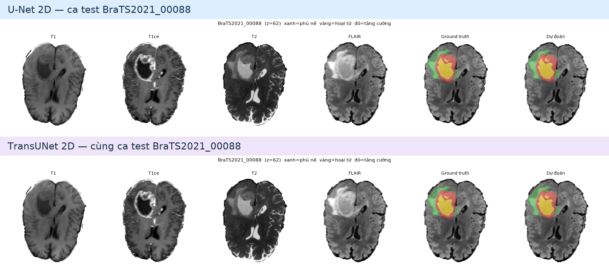

**Hình 4.2.** So sánh U-Net 2D và TransUNet 2D trên cùng lát cắt của ca test
`BraTS2021_00088`. Mỗi hàng gồm bốn modality, ground truth và dự đoán; nhờ đó
có thể quan sát trực tiếp khác biệt ở biên WT, TC và ET. Nguồn: kết quả đánh giá
từ checkpoint `best.pt` của hai run chính.

Ngoài ca test trên, pipeline demo còn được kiểm tra end-to-end với ca
`BraTS2021_00495`. Ca này không thuộc split 200 nên chỉ dùng để minh họa giao
diện và kiểm tra tính nhất quán của pipeline.

**Bảng 4.6. Dice trên ca demo BraTS2021_00495**

| Mô hình | WT | TC | ET | Mean |
|---|---:|---:|---:|---:|
| **U-Net 2D** | 0,9589 | 0,9679 | 0,9230 | **0,9499** |
| TransUNet 2D | 0,8584 | 0,9321 | 0,8976 | 0,8960 |

Ca 00495 là một ca thuận lợi và không thuộc tập test 30 ca. Không được dùng kết
quả này thay cho benchmark chính.

## 4.4. Phân tích chi tiết theo vùng u

### 4.4.1. Whole Tumor

WT đạt Dice cao nhất hoặc gần cao nhất ở cả hai mô hình. Vùng này thường có kích
thước lớn và biểu hiện rõ trên FLAIR. Sai số chủ yếu xuất hiện ở rìa phù lan tỏa
hoặc dự đoán thiếu những nhánh tổn thương mảnh.

### 4.4.2. Tumor Core

TC là vùng có chênh lệch lớn nhất giữa hai mô hình. Trong TransUNet, query phải
đồng thời học lớp và mask. Khi xác suất lớp TC thấp, mask có hình dạng tương đối
đúng vẫn có thể không được đưa vào kết quả cuối. Đây là một nguyên nhân cần phân
tích sâu bằng phân bố class score và assignment của query.

### 4.4.3. Enhancing Tumor

ET thường nhỏ, có thể rỗng ở một số ca và nhạy với sai lệch vài voxel. T1ce cung
cấp tín hiệu quan trọng nhưng vùng bắt thuốc có hình dạng phức tạp. Mô hình cần
cân bằng giữa bỏ sót ET và tạo cụm dương tính giả.

### 4.4.4. Vì sao U-Net đang tốt hơn?

1. CNN có thiên kiến cục bộ phù hợp khi số ca huấn luyện hạn chế.
2. U-Net dự đoán trực tiếp ba kênh, bài toán tối ưu đơn giản hơn.
3. TransUNet phải học thêm query, class, no-object và Hungarian assignment.
4. Hai mươi epoch có thể chưa đủ để decoder query hội tụ ổn định.
5. Cả hai mô hình đều là 2D, nên Transformer chưa được khai thác trên chuỗi
   voxel 3D như thiết kế gốc.

Kết quả không chứng minh U-Net luôn tốt hơn Transformer; nó chỉ phản ánh cấu
hình, dữ liệu và ngân sách của thí nghiệm này.

## 4.5. So sánh với công trình 3D TransUNet

Paper 3D TransUNet [3] báo cáo trên BraTS 2021 với mô hình 3D đầy đủ, 5-fold và tài
nguyên lớn hơn. Số liệu paper được trình bày chỉ để tham khảo, không phải phép so
sánh trực tiếp.

| Phương pháp | ET | TC | WT | Mean | Ghi chú |
|---|---:|---:|---:|---:|---|
| 3D TransUNet paper | 0,8885 | 0,9248 | 0,9390 | 0,9174 | 3D, 5-fold, thiết lập khác |
| U-Net 2D của nhóm | 0,8296 | 0,8566 | 0,8701 | 0,8521 | 30 ca test, 20 epoch |
| TransUNet 2D của nhóm | 0,7885 | 0,7820 | 0,8288 | 0,7997 | Decoder-only thu nhỏ |

Không thể kết luận chênh lệch chỉ đến từ kiến trúc vì còn khác số chiều, số ca,
số epoch, augmentation, cross-validation và GPU.

## 4.6. Ứng dụng demo Streamlit

Giao diện demo được xây dựng như một lớp trình bày trên pipeline suy luận. Người
dùng chọn model, cung cấp bốn modality, tùy chọn ground truth và nhấn chạy dự
đoán. Kết quả bao gồm:

- thông tin trạng thái checkpoint và thiết bị;
- lát cắt MRI theo modality;
- mask WT/TC/ET và overlay màu;
- Dice theo vùng nếu có ground truth;
- số voxel/thể tích vùng;
- file NIfTI dự đoán để tải về.

Lệnh chạy:

```powershell
cd D:\XLA\Brain-Tumor-segmentation
python -m streamlit run app.py
```

Ứng dụng phục vụ trình diễn học thuật, không phải phần mềm y tế.

## 4.7. Độ trễ và hiệu năng

### 4.7.1. Tham số và thời gian huấn luyện

**Bảng 4.7. Quy mô mô hình và thời gian từ log**

| Mô hình | Tham số | Tham số FP32 | `best.pt` huấn luyện | Trung bình/epoch | Tổng 20 epoch |
|---|---:|---:|---:|---:|---:|
| U-Net 2D | 5,686M | khoảng 21,7 MiB | 65,1 MiB | 83,6 giây | 27,87 phút |
| TransUNet 2D | 8,568M | khoảng 32,7 MiB | 98,2 MiB | 204,1 giây | 68,03 phút |

Dung lượng “tham số FP32” là ước lượng chỉ cho tensor trọng số. File `best.pt`
lớn hơn vì còn lưu trạng thái optimizer, scaler, epoch và cấu hình để resume.

TransUNet mất khoảng 2,44 lần thời gian/epoch so với U-Net. Nguyên nhân gồm
cross-attention, nhiều đầu ra trung gian và Hungarian matching.

Smoke test TransUNet 2D trong tài liệu setup ghi nhận khoảng **0,84 GB VRAM** và
**2,25 giây/bước** ở batch 8. Đây là số đo smoke test, không phải latency suy
luận toàn ca.

### 4.7.2. Latency suy luận

Kho dự án chưa lưu benchmark chuẩn hóa thời gian suy luận cho từng ca 3D. Vì
vậy báo cáo không tự tạo một con số latency không có bằng chứng. Khi hoàn thiện
Word, nhóm chỉ nên điền kết quả sau khi chạy giao thức:

1. cố định GPU/CPU, phiên bản PyTorch và batch suy luận;
2. warm-up ít nhất 5 lần;
3. đo tối thiểu 30 ca bằng CUDA event hoặc `perf_counter` có synchronize;
4. báo cáo median, mean, độ lệch chuẩn và peak VRAM;
5. tách thời gian đọc NIfTI, preprocessing, forward và hậu xử lý.

Với DAU-Mamba 3D, cần báo cáo thêm số cửa sổ/ca và ảnh hưởng của overlap 0,5.

## 4.8. Các đe dọa đến tính hợp lệ

- Tập con 200 ca nhỏ hơn toàn bộ BraTS 2021.
- Chỉ chạy một seed và một cách chia dữ liệu.
- Validation định kỳ chỉ dùng 10 ca.
- Hai mô hình chính là 2D, thiếu ngữ cảnh liên lát.
- Chưa báo cáo khoảng tin cậy hoặc kiểm định thống kê.
- Chưa đo benchmark latency toàn volume theo giao thức thống nhất.
- Chưa đánh giá trên dữ liệu ngoài miền hoặc từ bệnh viện khác.
- Con số Dice mean `0,7328` trong slide cũ không có cùng lineage log/checkpoint
  với hai run chính nên không được dùng trong bảng kết quả.
- DAU-Mamba và CGR-Mamba chưa được triển khai thực nghiệm.

---

# Chương 5. KẾT LUẬN VÀ PHÁT TRIỂN

## 5.1. Tổng kết kết quả

Đề tài đã xây dựng được một pipeline hoàn chỉnh cho phân đoạn khối u não trên
MRI đa chuỗi xung, từ đọc dữ liệu, tiền xử lý, lấy mẫu, huấn luyện, suy luận,
đánh giá đến trực quan hóa. Pipeline bảo toàn ba vùng WT, TC, ET và áp đặt quan
hệ lồng nhau trước khi xuất mặt nạ BraTS.

Hai mô hình đã được đánh giá công bằng trên cùng split. U-Net 2D đạt Dice mean
0,8521 và tốt hơn TransUNet 2D ở cả ba vùng cũng như HD95. Kết quả xác nhận U-Net
là baseline mạnh, ổn định và phù hợp với giới hạn GPU 4 GB. TransUNet có kiến
trúc linh hoạt hơn nhưng đòi hỏi quá trình tối ưu phức tạp và thời gian huấn
luyện dài hơn.

Đề tài cũng xây dựng giao diện Streamlit có thể dùng trong buổi báo cáo để minh
họa ảnh MRI, ground truth, dự đoán và Dice. Đây là cầu nối giữa phần nghiên cứu
mô hình và khả năng trình diễn sản phẩm.

Cuối cùng, báo cáo đề xuất DAU-Mamba cho phân đoạn 3D. Thiết kế kết hợp CNN và
Mamba theo ba hướng thích nghi, đồng thời dùng entropy điều khiển skip connection.
Đóng góp này mới ở mức thiết kế và chưa được khẳng định bằng số liệu.

## 5.2. Hạn chế của đề tài

1. **Quy mô dữ liệu:** mới dùng 200 ca, chưa khai thác toàn bộ BraTS 2021.
2. **Mô hình 2D:** mỗi lát được xử lý độc lập, bỏ qua liên tục theo trục z.
3. **Ngân sách huấn luyện:** 20 epoch ít hơn nhiều so với các thiết lập paper.
4. **Đánh giá:** mới có một seed, chưa có cross-validation và khoảng tin cậy.
5. **Phần cứng:** GPU 4 GB giới hạn kích thước patch và mô hình 3D.
6. **Hậu xử lý:** chưa khảo sát connected components hoặc hiệu chỉnh ngưỡng theo
   vùng trên validation.
7. **Hiệu năng:** chưa lưu latency end-to-end theo từng ca.
8. **Tính khái quát:** chưa kiểm thử ngoài miền và chưa đánh giá dữ liệu thiếu
   modality.
9. **Kiến trúc đề xuất:** DAU-Mamba chưa có code, checkpoint, FLOPs hoặc kết quả.

## 5.3. Hướng nghiên cứu tiếp theo

### 5.3.1. Triển khai DAU-Mamba 3D

Ưu tiên đầu tiên là cài đặt phiên bản nhỏ có thể chạy trên GPU hiện có. Sau khi
smoke test forward/backward, cần kiểm tra shape, gradient, VRAM và tốc độ trước
khi train dài.

### 5.3.2. Ablation study

**Bảng 5.1. Kế hoạch ablation DAU-Mamba**

| Mã | Mô hình | Mục tiêu kiểm chứng |
|---|---|---|
| A0 | 3D residual U-Net | Baseline CNN 3D |
| A1 | A0 + DSH, cộng đều hướng | Lợi ích Mamba đa hướng |
| A2 | A1 + trọng số hướng thích nghi | Đóng góp direction-adaptive |
| A3 | A0 + UGSF | Đóng góp uncertainty-guided skip |
| A4 | DSH thích nghi + UGSF | DAU-Mamba đầy đủ |
| A5 | CGR-Mamba | So sánh với coarse-guided refinement |

Mỗi thí nghiệm cần báo cáo Dice, HD95, tham số, FLOPs, peak VRAM, thời gian
train/epoch và latency/ca. Nên chạy tối thiểu ba seed và trình bày mean ± standard
deviation.

### 5.3.3. Mở rộng dữ liệu và giao thức đánh giá

- Sử dụng toàn bộ dữ liệu BraTS có nhãn.
- Thực hiện 5-fold cross-validation hoặc ít nhất ba split độc lập.
- Phân tích riêng ca u nhỏ, ca region rỗng và ca đa ổ.
- Đánh giá robust khi thiếu một modality.
- Kiểm thử ngoài miền nếu có dữ liệu hợp pháp từ nguồn khác.

### 5.3.4. Tối ưu suy luận

- dùng AMP và `torch.compile` khi tương thích;
- thử ONNX Runtime hoặc TensorRT sau khi xác nhận sai số số học;
- khảo sát overlap sliding window và batch cửa sổ;
- đo riêng I/O, preprocessing, model và postprocessing;
- không đánh đổi độ chính xác vùng ET chỉ để giảm latency.

### 5.3.5. Cải thiện tính tin cậy

- hiệu chỉnh xác suất trên validation;
- hiển thị uncertainty map cho người dùng;
- bổ sung cảnh báo khi modality sai thứ tự hoặc affine không khớp;
- lưu metadata mô hình, config và commit cùng kết quả;
- giữ tuyên bố sử dụng nghiên cứu, không chẩn đoán tự động.

---

# TÀI LIỆU THAM KHẢO

[1] O. Ronneberger, P. Fischer, and T. Brox, “U-Net: Convolutional Networks for
Biomedical Image Segmentation,” *MICCAI*, 2015.  
[PDF nội bộ](1505.04597v1.pdf) ·
[arXiv](https://arxiv.org/abs/1505.04597) ·
[DOI](https://doi.org/10.1007/978-3-319-24574-4_28)

[2] A. Hatamizadeh et al., “UNETR: Transformers for 3D Medical Image
Segmentation,” *WACV*, 2022.  
[PDF nội bộ](2103.10504v3.pdf) ·
[arXiv](https://arxiv.org/abs/2103.10504) ·
[MONAI Research](https://monai.io/research/unetr)

[3] C. Chen et al., “3D TransUNet: Advancing Medical Image Segmentation through
Vision Transformers,” 2023.  
[arXiv](https://arxiv.org/abs/2310.07781) ·
[Mã nguồn](https://github.com/Beckschen/3D-TransUNet)

[4] A. Gu and T. Dao, “Mamba: Linear-Time Sequence Modeling with Selective State
Spaces,” 2023.  
[arXiv](https://arxiv.org/abs/2312.00752) ·
[Mã nguồn](https://github.com/state-spaces/mamba)

[5] U. Baid et al., “The RSNA-ASNR-MICCAI BraTS 2021 Benchmark on Brain Tumor
Segmentation and Radiogenomic Classification,” 2021.  
[arXiv](https://arxiv.org/abs/2107.02314) ·
[BraTS 2021](https://www.med.upenn.edu/cbica/brats2021/)

[6] J. Ma, F. Li, and B. Wang, “U-Mamba: Enhancing Long-range Dependency for
Biomedical Image Segmentation,” 2024.  
[arXiv](https://arxiv.org/abs/2401.04722) ·
[Trang dự án](https://wanglab.ai/u-mamba.html)

[7] Y. Yue and Z. Li, “MedMamba: Vision Mamba for Medical Image Classification,”
2024.  
[PDF nội bộ](MedMamba_Vision_Mamba_2024.pdf) ·
[arXiv](https://arxiv.org/abs/2403.03849) ·
[Mã nguồn](https://github.com/YubiaoYue/MedMamba)

[8] Z. Xing, T. Ye, Y. Yang, G. Liu, and L. Zhu, “SegMamba: Long-range Sequential
Modeling Mamba for 3D Medical Image Segmentation,” 2024.  
[PDF nội bộ](SegMamba_3D_Medical_Segmentation_2024.pdf) ·
[arXiv](https://arxiv.org/abs/2401.13560) ·
[Mã nguồn](https://github.com/ge-xing/SegMamba)

[9] D. Das et al., “SegResMamba: An Efficient 3D Medical Image Segmentation
Architecture with Mamba,” 2025.  
[PDF nội bộ](SegResMamba_Efficient_3D_Segmentation_2024.pdf) ·
[arXiv](https://arxiv.org/abs/2503.07766)

[10] Đặc tả nội bộ, “DAU-Mamba: Direction-Adaptive and Uncertainty-Guided
CNN–Mamba,” 2026.  
[DAU_Mamba_Kien_truc.md](DAU_Mamba_Kien_truc.md)

[11] Đặc tả nội bộ, “CGR-Mamba: Coarse-Guided Residual Mamba Network,” 2026.  
[CGR_Mamba_Kien_Truc.md](CGR_Mamba_Kien_Truc.md)

[12] Nhóm dự án, “Phân đoạn khối u não bằng TransUNet3D,” slide báo cáo lịch sử.  
[PDF nội bộ](Ph%C3%A2n%20%C4%91o%E1%BA%A1n%20kh%E1%BB%91i%20u%20n%C3%A3o%20b%E1%BA%B1ng%20TransUNet3D.pdf)

## Liên kết mã nguồn và công cụ

- [HK7-CV-Class](https://github.com/nhatminh65537/HK7-CV-Class)
- [Brain Tumor Segmentation Demo](https://github.com/Phucluu2809/Brain_Tumor_segmentation)
- [PyTorch](https://pytorch.org/docs/stable/index.html)
- [MONAI](https://docs.monai.io/)
- [NiBabel](https://nipy.org/nibabel/)
- [Streamlit](https://docs.streamlit.io/)

---

# PHỤ LỤC A. CẤU TRÚC MÃ NGUỒN

```text
XLA/
├── HK7-CV-Class/
│   └── brats-transunet/
│       ├── configs/
│       │   ├── base.yaml
│       │   ├── unet2d.yaml
│       │   ├── transunet2d.yaml
│       │   ├── unet3d_small.yaml
│       │   └── transunet3d_small.yaml
│       ├── data/
│       │   └── splits_200.json
│       ├── src/brats/
│       │   ├── io.py
│       │   ├── preprocess.py
│       │   ├── datasets.py
│       │   ├── losses.py
│       │   ├── metrics.py
│       │   ├── inference.py
│       │   └── models/
│       ├── train.py
│       ├── evaluate.py
│       ├── runs/
│       └── figures/
└── Brain-Tumor-segmentation/
    ├── app.py
    ├── brats_demo/
    ├── scripts/
    └── knowledge/
        ├── README.md
        ├── assets/dau_mamba_architecture.png
        ├── DAU_Mamba_Kien_truc.md
        ├── CGR_Mamba_Kien_Truc.md
        └── *.pdf
```

---

# PHỤ LỤC B. LỆNH TÁI LẬP

Chạy trong `HK7-CV-Class/brats-transunet`.

## B.1. Huấn luyện U-Net

```powershell
python train.py --config configs/unet2d.yaml `
  --opts splits=data/splits_200.json `
  output_dir=runs/unet2d_200 `
  train.epochs=20
```

## B.2. Huấn luyện TransUNet

```powershell
python train.py --config configs/transunet2d.yaml `
  --opts splits=data/splits_200.json `
  output_dir=runs/tu2d_200 `
  train.epochs=20
```

## B.3. Đánh giá

```powershell
python evaluate.py --config configs/unet2d.yaml `
  --checkpoint runs/unet2d_200/best.pt --split test

python evaluate.py --config configs/transunet2d.yaml `
  --checkpoint runs/tu2d_200/best.pt --split test
```

## B.4. Chạy giao diện

```powershell
cd D:\XLA\Brain-Tumor-segmentation
python -m streamlit run app.py
```

---

# PHỤ LỤC C. NGUỒN SỐ LIỆU

| Nội dung | File nguồn |
|---|---|
| Split 200 ca | `../../HK7-CV-Class/brats-transunet/data/splits_200.json` |
| Cấu hình chung | `../../HK7-CV-Class/brats-transunet/configs/base.yaml` |
| Log U-Net | `../../HK7-CV-Class/brats-transunet/runs/unet2d_200/log.csv` |
| Test U-Net | `../../HK7-CV-Class/brats-transunet/runs/unet2d_200/eval_test/metrics.csv` |
| Log TransUNet | `../../HK7-CV-Class/brats-transunet/runs/tu2d_200/log.csv` |
| Test TransUNet | `../../HK7-CV-Class/brats-transunet/runs/tu2d_200/eval_test/metrics.csv` |
| Mã U-Net | `../../HK7-CV-Class/brats-transunet/src/brats/models/unet.py` |
| Mã TransUNet | `../../HK7-CV-Class/brats-transunet/src/brats/models/transunet.py` |
| Loss | `../../HK7-CV-Class/brats-transunet/src/brats/losses.py` |
| Suy luận | `../../HK7-CV-Class/brats-transunet/src/brats/inference.py` |

Quy ước sử dụng số liệu:

- validation lấy từ `log.csv` và dựa trên 10 ca được đánh giá định kỳ;
- test là trung bình 30 dòng trong `metrics.csv`;
- ca 00495 chỉ dùng minh họa;
- không gán kết quả U-Net/TransUNet cho DAU-Mamba hoặc CGR-Mamba;
- khi chạy lại phải ghi seed, config, checkpoint, commit và phần cứng.

---

# PHỤ LỤC D. GỢI Ý DÀN TRANG WORD

1. Dùng Heading 1 cho tên chương, Heading 2 cho mục hai cấp và Heading 3 cho
   mục ba cấp để Word tự tạo mục lục.
2. Đánh số hình theo chương: Hình 2.1, Hình 3.1, Hình 4.1.
3. Đặt tên bảng phía trên bảng và tên hình phía dưới hình.
4. Công thức trong README dùng `$...$` cho inline và `$$...$$` cho display để
   hiển thị đúng trên Markdown hỗ trợ MathJax/KaTeX. Khi đưa vào Word, nhấn
   `Alt` + `=` rồi dán phần nội dung nằm giữa hai dấu `$$`; chọn chế độ nhập
   LaTeX nếu Word chưa tự nhận dạng.
5. Đặt trích dẫn dạng `[1]`, `[2]` theo danh mục tài liệu tham khảo.
6. Với kiến trúc đề xuất, dùng `dau_mamba_architecture.png` cho Hình 3.2,
   `dsh_block.png` cho Hình 3.3 và `ugsf_block.png` cho Hình 3.4.
7. Các hình kỹ thuật có thể sinh lại bằng lệnh
   `.\myenv\Scripts\python.exe knowledge\scripts\generate_report_figures.py`.
8. Không đưa con số latency suy luận vào bản nộp cho đến khi có log benchmark.
9. Giữ phần tuyên bố phạm vi: sản phẩm phục vụ nghiên cứu và giảng dạy, không
   thay thế chẩn đoán y khoa.

---

> **Lưu ý đạo đức và sử dụng:** Hệ thống được xây dựng cho mục đích nghiên cứu,
> học tập và trình diễn. Kết quả dự đoán không phải chẩn đoán y khoa, không thay
> thế bác sĩ và không được sử dụng độc lập để quyết định điều trị.
